# Guide utilisateur AiHarness

AiHarness fournit deux interfaces sur les mêmes providers et le même stockage de sessions :

- **CLI** : agent interactif dans un terminal, avec sessions, branches, outils, skills et extensions ;
- **Web** : espace de travail React à trois panneaux, connecté à un agent serveur détaché avec reprise SSE séquencée.

Ce guide décrit l’installation depuis les sources, la configuration des providers et l’usage quotidien des deux interfaces.

## Sommaire

- [Installation](#installation)
- [Démarrage rapide](#démarrage-rapide)
- [Configuration des providers](#configuration-des-providers)
- [Utiliser le CLI](#utiliser-le-cli)
- [Utiliser l’interface Web](#utiliser-linterface-web)
- [Sessions et fichiers](#sessions-et-fichiers)
- [Sécurité](#sécurité)
- [Dépannage](#dépannage)

## Installation

### Prérequis

- Node.js 22.22.2+, 24.15.0+ ou 26+ ;
- npm 12.1.0+ ;
- une clé d’API ou un serveur local compatible OpenAI pour utiliser un vrai modèle.

Le provider `mock` est disponible sans configuration pour découvrir l’application.

### Installation depuis les sources

```bash
git clone https://github.com/Fidigi/AiHarness.git
cd AiHarness
npm install
npm run link:global
```

### Installer les commandes `ai-harness` et `ai-harness-web`

La commande `npm run link:global` construit le projet et installe deux exécutables liés à ce dépôt :

- `ai-harness` pour le terminal ;
- `ai-harness-web` pour l’application Web complète.

Vous pouvez ensuite les lancer depuis n’importe quel dossier. Vérifiez que le dossier global de npm est présent dans votre `PATH` si une commande reste introuvable.

Les liens globaux pointent vers ce dépôt. Après une modification du code, relancez `npm run build` ; il n’est pas nécessaire de recréer les liens.

## Démarrage rapide

### Terminal

```bash
ai-harness
```

### Web

```bash
ai-harness-web
```

Le navigateur s’ouvre automatiquement sur [http://127.0.0.1:3080](http://127.0.0.1:3080). Utilisez `Ctrl+C` pour arrêter le serveur.

## Configuration des providers

Les variables doivent être définies **avant** de démarrer le CLI ou le serveur Web.

| Provider | Variables principales | Variables facultatives |
|---|---|---|
| OpenAI | `OPENAI_API_KEY` | `OPENAI_MODEL` en mode RPC |
| Anthropic | `ANTHROPIC_API_KEY` | `ANTHROPIC_MODEL` en mode RPC |
| Google Gemini | `GEMINI_API_KEY` ou `GOOGLE_API_KEY` | `GEMINI_MODEL` |
| Azure OpenAI | `AZURE_OPENAI_API_KEY`, `AZURE_OPENAI_ENDPOINT` | `AZURE_OPENAI_DEPLOYMENT`, `AZURE_OPENAI_API_VERSION` |
| Google Vertex AI | `GOOGLE_VERTEX_ACCESS_TOKEN`, `GOOGLE_CLOUD_PROJECT` | `GOOGLE_CLOUD_LOCATION`, `VERTEX_MODEL` |
| AWS Bedrock | `AWS_ACCESS_KEY_ID`, `AWS_SECRET_ACCESS_KEY` | `AWS_SESSION_TOKEN`, `AWS_REGION`, `BEDROCK_MODEL` |
| Local / Ollama / llama.cpp / AirNES | `LOCAL_BASE_URL` ou `LLAMA_BASE_URL` | `LOCAL_API_KEY`/`LLAMA_API_KEY`, `LOCAL_MODEL`/`LLAMA_MODEL` |

Exemple OpenAI :

```bash
export OPENAI_API_KEY='sk-...'
```

Exemple Ollama :

```bash
export LOCAL_BASE_URL='http://127.0.0.1:11434/v1'
export LOCAL_MODEL='qwen2.5-coder'
```

Exemple AirNES :

```bash
export LLAMA_BASE_URL='http://127.0.0.1:8888'
export LLAMA_API_KEY='llama-cpp'
export LLAMA_MODEL='Qwen3.6-35B-A3B-UD-IQ4_XS'
```

AiHarness ajoute automatiquement `/v1` à l’URL locale côté serveur si nécessaire.

## Utiliser le CLI

### Démarrage

Après l’installation globale décrite plus haut, la commande normale est :

```bash
ai-harness
```

Pour travailler directement depuis les sources, sans lien global :

```bash
npm run dev:cli
```

Après `npm run build`, il reste également possible d’appeler directement le fichier compilé :

```bash
node packages/cli/dist/index.js
```

Le provider actif au démarrage est `mock`. Sélectionnez un provider configuré avant une conversation réelle :

```text
/provider
/provider openai
/model
/model gpt-4o
```

Saisissez ensuite un message et validez avec Entrée. La réponse est affichée progressivement.

### Options de lancement

| Option | Effet |
|---|---|
| `-h`, `--help` / `-v`, `--version` | affiche les métadonnées sans démarrer de session |
| `-p`, `--print` | exécute les prompts une fois et écrit uniquement la réponse finale sur stdout |
| `--mode json` | exécute les prompts une fois et écrit les événements de session/cycle de vie en JSONL |
| `--mode rpc` ou `--rpc` | active le protocole RPC JSONL sur stdin/stdout |
| `-a`, `--approve` / `-na`, `--no-approve` | autorise ou refuse le projet pour ce processus uniquement, sans modifier le registre de confiance |
| `--tui-mode fullscreen` / `regular` | sélectionne le mode terminal |
| `--fullscreen` / `--regular` / `--no-fullscreen` | anciens alias de mode terminal |
| `--provider <nom>` | limite `--model` ou `--models` à un provider |
| `--model <[provider/]modèle[:thinking]>` | sélectionne un modèle exact/flou et un niveau de raisonnement facultatif |
| `--models <motifs>` | définit une portée ordonnée de démarrage et de cycle interactif/RPC avec références exactes/floues ou globs |
| `--list-models [recherche]` | affiche les métadonnées des modèles de providers configurés, avec filtre flou facultatif, puis quitte |
| `--api-key <clé>` | applique une surcharge de credential non persistante ; exige `--model` ou `--models` |
| `--thinking <niveau>` | sélectionne `off`, `minimal`, `low`, `medium`, `high`, `xhigh` ou `max` |
| `--system-prompt <texte-ou-chemin>` | remplace le prompt système par un texte littéral ou un fichier existant |
| `--append-system-prompt <texte-ou-chemin>` | ajoute un texte littéral ou un fichier existant ; option répétable qui conserve l’ordre |
| `-nc`, `--no-context-files` | désactive la découverte automatique de `AGENTS.md` / `CLAUDE.md` |
| `-c`, `--continue` | reprend la session la plus récente du workspace courant |
| `-r`, `--resume` | ouvre un sélecteur interactif de sessions stockées |
| `--session <chemin-ou-id>` | ouvre un fichier, ID ou préfixe d’ID |
| `--session-id <id>` | ouvre ou crée un ID exact validé |
| `--fork <chemin-ou-id>` | crée un fork d’une session stockée avant le démarrage |
| `--session-dir <dossier>` | remplace le dossier de stockage/recherche des sessions |
| `-n`, `--name <nom>` | nomme ou renomme la session de démarrage |
| `--no-session` | conserve la conversation uniquement en mémoire |
| `--theme dark` / `--theme light` / `--theme system` | sélectionne un thème intégré ; `system` interroge sûrement la palette du terminal |
| `--theme <fichier.json>` | charge un thème personnalisé |
| `--extension <fichier-ou-dossier>` | charge une extension JavaScript explicite ; option répétable |

Exemples :

```bash
ai-harness --tui-mode regular --theme light
ai-harness --print --no-session "Résume ce dépôt"
git diff | ai-harness --print --no-session "Relis ce patch"
ai-harness --print --no-session @README.md "Résume ce fichier"
ai-harness --mode json --no-session "Relis ce dépôt"
ai-harness --list-models "sonnet 4"
ai-harness --models 'openai/o*:high,anthropic/*sonnet*:medium' --mode rpc
ai-harness --system-prompt ./SYSTEM.md --append-system-prompt "Privilégie les petits changements"
ai-harness --continue "Poursuis le travail précédent"
ai-harness --session-id revue-42 --name "Revue 42"
ai-harness --fork revue-42 --session-id revue-42-alternative
```

Les prompts positionnels sont envoyés dans l’ordre. `@chemin` est résolu dans le workspace de démarrage et accepte du texte UTF-8 borné ou des images PNG/JPEG/GIF/WebP ; les traversées, liens symboliques sortants, fichiers texte binaires et entrées trop volumineuses sont refusés. Une redirection de stdin ou stdout sélectionne automatiquement le mode print. Une option inconnue est une erreur ; utilisez `--` avant un prompt commençant par `-`.

La résolution teste l’ID complet avant d’interpréter son dernier deux-points comme suffixe de raisonnement : les ID contenant `/` ou `:` restent donc valides. Un ID nu partagé entre plusieurs providers n’est résolu que si exactement un provider correspondant est configuré ; sinon, qualifiez-le. La recherche floue privilégie un alias non daté ou `-latest`, puis l’ID lexicalement le plus récent. Les motifs de portée sont ordonnés, dédupliqués et prennent en charge les globs `*`, `?` et crochets sans distinction de casse ; le premier résultat disponible démarre le run sauf sélection différente par `--model`, puis `/model cycle` et RPC réutilisent cette portée. La découverte est bornée en durée et en nombre de résultats. Les catalogues et sessions ne conservent jamais `--api-key`, mais un secret passé en argument peut rester visible dans l’historique du shell ou la liste des processus : préférez les variables d’environnement du provider pour un credential durable.

Sans sélecteur de session, chaque invocation démarre une nouvelle session. `--resume` exige un terminal interactif ; utilisez `--session` ou `--continue` pour l’automatisation print/JSON. Un chemin de session explicite prévaut ; sinon l’ordre du stockage est `--session-dir`, `AI_HARNESS_SESSIONS_DIR`, le réglage `sessionDir`, puis le dossier par défaut. Les sélecteurs incompatibles échouent avant l’exécution. Les ID sont limités à 256 octets, chaque fichier JSONL à 64 Mio et la découverte à 10 000 fichiers. Les fichiers sont privés, ouverts sans suivi et lus avec contrôle de stabilité ; append/save/delete sont sérialisés par verrou entre processus coopérants et les réécritures sont atomiques. La découverte tardive d’un credential provoque aussi la réécriture expurgée des anciennes sessions.

La variable `AI_HARNESS_TUI_MODE=regular|fullscreen` permet aussi de définir le mode. L’option en ligne de commande reste prioritaire sur les réglages.

### Réglages de l’agent

Le CLI et RPC utilisent le résolveur de réglages du Core AiHarness. Avant confiance, `AI_HARNESS_AGENT_DIR` n’est accepté que si son chemin canonique est sans lien symbolique et extérieur au workspace ; sinon Core choisit un répertoire indépendant home/XDG/temporaire lié à l’UID, ou s’arrête sûrement. Un projet ne peut donc pas fournir lui-même son `trust.json`, ses réglages ou credentials. Le résolveur lit `<répertoire-agent>/settings.json`, puis superpose `<workspace>/.ai-harness/settings.json` après résolution positive de la confiance du projet. Aucun contenu de réglage projet n’est lu avant cette résolution ; un `sessionDir` projet ne participe à la priorité de stockage qu’après confiance. Les sources doivent être des fichiers JSON UTF-8 réguliers, sans lien symbolique ni lien dur, de 256 Kio au plus par défaut ; un champ invalide ou inconnu produit un avertissement sans afficher sa valeur. Ces réglages sont en lecture seule : AiHarness ne réécrit jamais les fichiers.

Voici un point de départ :

```json
{
  "defaultProvider": "mock",
  "defaultModel": "mock-model-v1",
  "defaultThinkingLevel": "medium",
  "enabledModels": ["mock/*", "openai/o*:high"],
  "defaultTools": ["read", "bash", "edit", "write", "+grep"],
  "sessionDir": "./sessions",
  "compaction": { "enabled": true, "reserveTokens": 16384, "keepRecentTokens": 20000 },
  "retry": { "enabled": true, "maxRetries": 3, "baseDelayMs": 2000 },
  "steeringMode": "one-at-a-time",
  "followUpMode": "one-at-a-time",
  "defaultProjectTrust": "ask",
  "tuiMode": "fullscreen",
  "theme": "system"
}
```

Sont aussi appliqués : `modelThinkingLevels` exact, les `modelOverrides` de compaction, `defaultProjectTrust` global (`ask`, `always` ou `never`), `externalEditor`, `quietStartup: true`, `shellPath`, `shellCommandPrefix`, les chemins locaux d’extensions/skills/prompts, `enableSkillCommands`, les modificateurs projet de `defaultTools`, la politique réseau provider et les commandes de credentials de confiance. Les runs Web détachés et approuvés résolvent aussi `steeringMode` et `followUpMode` au démarrage via le même chargeur et ordonnanceur Core. Les options CLI explicites restent prioritaires. `/settings` affiche les valeurs effectives et leurs sources `global`/`project`, jamais la valeur du proxy ni les commandes de credentials. `/reload` recharge confiance, réglages, credentials, réseau/providers/modèle/thinking, instructions, ressources, extensions, outils, files, callbacks shell et thème actif ; les choix de confiance limités au processus restent inchangés. Redémarrez pour changer le dossier de sessions, le type de renderer terminal ou les valeurs initiales RPC. Les commutateurs d’extensions intégrées, la génération de résumés de branche, codemode, les options terminal/image/Markdown détaillées, la télémétrie et les avertissements ne sont pas encore appliqués.

### Instructions du projet et prompts système

AiHarness applique le même résolveur d’instructions aux runs agent interactifs, print, JSON, RPC et Web. Son répertoire agent utilisateur est `AI_HARNESS_AGENT_DIR` ou, si cette variable n’est pas définie, `~/.ai-harness`. Dans ce répertoire, puis dans chaque dossier parent approuvé depuis la racine du système de fichiers jusqu’au dossier de démarrage, il sélectionne le premier nom existant de cette liste prioritaire :

1. `AGENTS.override.md`
2. `AGENTS.md`
3. `AGENTS.MD`
4. `CLAUDE.md`
5. `CLAUDE.MD`

Le fichier du répertoire agent appartient à l’utilisateur et peut être chargé avant l’approbation d’un projet. Avant toute lecture du contenu projet, AiHarness inventorie seulement des métadonnées de chemins bornées. En mode interactif et avec `defaultProjectTrust: "ask"`, il demande une décision uniquement si des réglages, instructions, skills, prompts ou extensions protégés existent ; les modes print, JSON et RPC sans décision refusent alors ces ressources. Les fichiers des parents/du projet ne sont chargés qu’après résolution de la confiance. Si vous lancez `/trust allow` dans un CLI déjà actif, exécutez ensuite `/reload` pour recalculer les instructions. `--no-context-files` désactive la découverte des fichiers de contexte utilisateur et projet, mais pas `SYSTEM.md` ni `APPEND_SYSTEM.md`.

Pour le prompt système de base, `--system-prompt` a la priorité, puis `<workspace>/.ai-harness/SYSTEM.md` si le projet est approuvé, puis `<répertoire-agent>/SYSTEM.md`, enfin le prompt intégré. Sans option d’ajout explicite, `<workspace>/.ai-harness/APPEND_SYSTEM.md` approuvé prévaut sur `<répertoire-agent>/APPEND_SYSTEM.md`. Répéter `--append-system-prompt` remplace ce choix automatique et conserve l’ordre de la ligne de commande. Une valeur CLI correspondant à un chemin existant est lue comme fichier ; sinon elle devient du texte littéral. Le réglage Web du prompt système reste toujours littéral et ne peut donc pas lire inopinément un chemin du serveur.

Les sources d’instructions doivent être des fichiers UTF-8 réguliers, non symboliques, et restent bornées individuellement et globalement. Leur contenu résolu est envoyé au provider choisi sans être copié dans les réglages de session. Vérifiez les instructions d’un projet avant d’approuver son workspace : elles peuvent influer sur les décisions du modèle et ses demandes d’outils, même si l’exécution des outils conserve ses propres contrôles de confiance.

### Raccourcis et saisie

| Action | Raccourci/commande |
|---|---|
| Envoyer la saisie ou orienter une réponse active | `Entrée` |
| Mettre du travail en attente après la tâche active | `Alt+Entrée` (`Ctrl+Q` en secours) |
| Rappeler le texte en file dans l’éditeur | `Alt+↑` |
| Compléter une commande, un skill ou un prompt | `Tab` |
| Parcourir l’historique de saisie | `↑` / `↓` |
| Interrompre une réponse ou une commande shell en cours | `Escape` ou `Ctrl+C` |
| Quitter lorsqu’aucune opération n’est active | `Ctrl+C`, `Ctrl+D` ou `/quit` |
| Ouvrir `$VISUAL` ou `$EDITOR` | `Ctrl+G` |
| Rafraîchir l’écran | `Ctrl+L` |
| Faire défiler le transcript en plein écran | `Alt+↓` ; `Alt+↑` si aucune saisie n’est en file |

Pendant une réponse, `Entrée` ajoute un message de steering à la prochaine frontière de modèle ; `Alt+Entrée` attend que le steering et la tâche courante soient terminés. `steeringMode` et `followUpMode` indiquent si un seul message ou tous les messages en attente de ce type sont livrés à chaque frontière. `Alt+↑`, `Escape`, `Ctrl+C` ou l’échec du run restitue le texte en attente dans l’éditeur au lieu de le perdre. Les commandes et saisies shell `!` ne sont pas exécutées en parallèle d’une réponse active. Un court délai distingue `Escape` seul des terminaux qui séparent `Alt+Entrée` ; `Escape` ne quitte jamais le CLI au repos. Certains terminaux réservent `Alt+Entrée` ; utilisez alors `Ctrl+Q`.

Pour une saisie multi-lignes dans le terminal classique :

```text
/edit
première ligne
seconde ligne
/send
```

Utilisez `/cancel` ou `Escape` pour abandonner la saisie multi-lignes.

Pour exécuter directement une commande dans le workspace approuvé, préfixez-la avec `!`. Sa sortie progressive, son statut et son code de sortie sont persistés dans la session puis ajoutés au contexte du modèle. Utilisez `!!` pour conserver le même historique sans transmettre le résultat au modèle :

```text
!git status
!!git diff --stat
```

`Escape` ou `Ctrl+C` arrête l’arbre de processus actif. La sortie affichée et persistée est bornée ; si elle est tronquée, le CLI indique le chemin d’un fichier complet privé qui expire après 24 heures. Les commandes refusent un workspace non approuvé (`/trust allow`) et leurs processus n’héritent pas des variables d’environnement dont le nom ressemble à un credential. Cette exécution directe et la commande Web reposent sur le même runtime Core ; elle reste distincte de l’outil `bash` appelé par le modèle.

### Commandes de conversation et de session

| Commande | Description |
|---|---|
| `/help` | affiche l’aide intégrée |
| `/new [titre]` | crée et active une conversation |
| `/list [recherche]` | liste ou filtre les conversations |
| `/switch <id-ou-numéro>` | active une conversation |
| `/name <titre>` ou `/rename <titre>` | renomme la conversation active |
| `/delete <id>` | supprime une conversation |
| `/clear` | efface les messages de la conversation courante |
| `/session [-a|--all]` | affiche les statistiques et l’estimation de tokens |
| `/search <texte>` | recherche dans le transcript affiché |
| `/copy` | copie la dernière réponse dans le presse-papiers |
| `/quit` ou `/exit` | quitte AiHarness |

### Provider, modèle et raisonnement

| Commande | Description |
|---|---|
| `/provider` | affiche les providers disponibles et leur état |
| `/provider <nom>` | sélectionne `openai`, `anthropic`, `google`, `local`, `azure`, `vertex`, `bedrock` ou `mock` si disponible |
| `/model` ou `/model list` | affiche le modèle courant et le catalogue du provider actif |
| `/model <[provider/]nom[:thinking]>` | choisit un modèle exact/flou, y compris parmi les providers configurés |
| `/model cycle` | passe au modèle suivant de la portée `--models` ordonnée, ou du catalogue du provider actif |
| `/thinking [off|minimal|low|medium|high|xhigh|max]` | affiche ou change le niveau de raisonnement |
| `/credentials` | liste les descripteurs et origines des credentials, jamais leurs valeurs |
| `/credential reveal <provider>` | révèle une valeur seulement dans un terminal local interactif |
| `/login <provider>` | lance un flux OAuth Device borné et configuré |
| `/logout <provider>` | supprime le credential mémoire/chiffré de ce provider |
| `/config` | affiche l’emplacement des sessions |
| `/settings` | affiche les réglages effectifs de l’agent et leurs sources |

Le support réel d’un niveau de raisonnement dépend du provider et du modèle.

Pour `/login openai`, par exemple, définissez :

```bash
export AI_HARNESS_OAUTH_OPENAI_DEVICE_URL='https://.../device'
export AI_HARNESS_OAUTH_OPENAI_TOKEN_URL='https://.../token'
export AI_HARNESS_OAUTH_OPENAI_CLIENT_ID='...'
export AI_HARNESS_OAUTH_OPENAI_SCOPE='...' # facultatif
```

Le préfixe suit la forme `AI_HARNESS_OAUTH_<PROVIDER>_*`. Avec `AI_HARNESS_MASTER_KEY`, les credentials sont chiffrés dans le répertoire agent indépendant et approuvé. Les credentials d’environnement, les commandes `providerApiKeyCommands` de confiance et les valeurs CLI explicites peuvent rester locales au processus sans cette clé, mais `/login` refuse avant tout accès réseau si le stockage chiffré persistant n’est pas disponible. L’ordre de résolution est : variables d’environnement provider, commandes de credentials de confiance, mémoire, puis stockage chiffré. Une commande de credential est une configuration exécutable : sa stdout bornée reste seulement en mémoire.

Les réglages réseau provider sont appliqués à l’exécution :

```json
{
  "transport": "websocket-cached",
  "httpProxy": "http://127.0.0.1:8080",
  "httpIdleTimeoutMs": 300000,
  "websocketConnectTimeoutMs": 15000,
  "retry": {
    "provider": { "timeoutMs": 300000, "maxRetries": 1, "maxRetryDelayMs": 5000 }
  },
  "providerApiKeyCommands": {
    "openai": "security find-generic-password -w -s openai"
  }
}
```

`auto` utilise le WebSocket OpenAI Responses avec un cache borné par session lorsqu’il est pris en charge, et ne se replie vers SSE qu’avant le premier événement WebSocket. Proxy HTTP(S), délais de handshake/requête/inactivité et retries sont bornés ; les erreurs ne répètent jamais URL, corps distant, headers ou credentials proxy. Les secrets runtime connus sont retirés des sessions, outils, sorties shell/terminal, diagnostics, JSON/RPC, HTTP, SSE et WebSocket, y compris encodés ou répartis entre plusieurs chunks. La commande locale exacte `/credential reveal` est l’unique exception volontaire.

### Outils de code intégrés

Le CLI et l’agent Web utilisent les mêmes implémentations d’outils fournies par le package Core :

| Outil | Usage |
|---|---|
| `read` | lit une fenêtre de fichier texte avec `offset` et `limit` |
| `grep` | recherche une expression régulière ou une chaîne dans les fichiers |
| `find` | recherche des fichiers par glob |
| `ls` | liste un répertoire |
| `edit` | applique des remplacements textuels exacts, uniques et non chevauchants |
| `write` | crée ou réécrit complètement un fichier |
| `bash` | exécute une commande shell bornée dans le workspace |
| `powershell` | équivalent Windows, disponible uniquement sur cet OS |

Par défaut, le modèle reçoit `read`, `bash`, `edit` et `write`, ainsi que les outils des extensions chargées ; `grep`, `find` et `ls` sont optionnels. Le réglage agent `defaultTools` peut remplacer ou modifier cette liste. `--tools <noms>` remplace la sélection, `--exclude-tools <noms>` en retire ensuite certains, `--no-builtin-tools` ne garde que les outils d’extension et `--no-tools` désactive tous les outils par défaut. `/tools` signale les outils inactifs et `/reload` réapplique la politique à la nouvelle génération d’extensions. `shellPath` et `shellCommandPrefix` affectent cet outil `bash` comme les commandes directes `!`/`!!`.

Tous les chemins sont canonicalisés dans le dossier depuis lequel le CLI a démarré ; les liens symboliques sortants et les traversées sont refusés. Les lectures et recherches sont disponibles sans exécuter de code. `bash`, `edit` et `write` exigent une confiance résolue. Un dossier sans ressource projet protégée est autorisé pour le processus courant sans enregistrer de marqueur ; si une telle ressource apparaît, `/reload` résout de nouveau la confiance et la bloque ou provoque une demande au prochain lancement interactif. Sinon, approuvez explicitement :

```text
/trust allow
/tools
/tool read {"path":"README.md","offset":1,"limit":80}
```

Les sorties de lecture, recherche, listing et commande sont limitées afin de ne pas saturer le contexte du modèle. L’outil `read` reste limité au texte, mais une entrée de démarrage `@image.png` utilise le pipeline multimodal partagé des messages et providers.

### Branches et contexte

| Commande | Description |
|---|---|
| `/compact [instructions]` | résume une conversation suffisamment longue avec le provider actif |
| `/summarize-branch [session-id] [instructions]` | enregistre un résumé sans supprimer les messages |
| `/fork <session-id> [index-message] [titre]` | crée une branche à partir d’un message |
| `/clone <session-id> [titre]` | copie toute une conversation |
| `/tree [branch-id]` | affiche l’arbre et les résumés de branches |

La compaction nécessite un provider configuré et au moins trois messages.

### Import, export et partage

```text
/export json [chemin]
/export markdown [chemin]
/export jsonl [chemin]
/export html [chemin]
/import <fichier.jsonl>
/share [durée-en-heures]
/bug [description]
```

Sans chemin, les exports sont créés dans `~/.ai-harness/exports/`. La commande `/import` accepte un JSON contenant un tableau de sessions ou un JSONL contenant un message par ligne.

`/share` nécessite le serveur AiHarness. Par défaut, le CLI l’appelle sur `http://127.0.0.1:3080`. Les variables utiles sont :

```bash
export AI_HARNESS_SERVER_URL='http://127.0.0.1:3080'
export AI_HARNESS_AUTH_TOKEN='...'       # si le serveur est protégé
export AI_HARNESS_ISSUES_URL='https://github.com/Fidigi/AiHarness/issues/new'
```

Les liens de partage expirent après 24 heures par défaut ; la durée acceptée est limitée à 1–168 heures et les liens sont perdus au redémarrage du serveur. Le CLI refuse les URL HTTP distantes, les credentials intégrés à l’URL et les redirections ; utilisez HTTPS pour tout serveur qui n’est pas loopback. La réponse est bornée et validée avant affichage.

### Skills et prompts

Le CLI découvre les skills `SKILL.md` dans :

- `~/.agents/skills/` et `<répertoire-agent>/skills/` (par défaut : `~/.ai-harness/skills/`) ;
- les dossiers approuvés `<projet>/.agents/skills/` et `<projet>/.ai-harness/skills/` ;
- les sélecteurs utilisateur/projet `skills` supplémentaires de `settings.json`.

Chaque skill CLI exige un frontmatter YAML avec `name` et `description`. Le `name` normalisé doit correspondre au répertoire parent, et le champ facultatif `disable-model-invocation` est strictement booléen.

Exemple `~/.ai-harness/skills/relecture/SKILL.md` :

```markdown
---
name: relecture
description: Relire et corriger un texte
disable-model-invocation: false
---

Corrige l’orthographe, la grammaire et explique brièvement les changements.
```

Commandes :

```text
/skills
/skill:relecture Texte à relire
```

Les prompts Markdown sont recherchés dans `<répertoire-agent>/prompts/` (par défaut : `~/.ai-harness/prompts/`), ainsi que dans les dossiers approuvés `<projet>/.ai-harness/prompts/` et `<projet>/prompts/`. Les chemins `skills`/`prompts` des réglages sont résolus depuis le dossier du fichier déclarant et acceptent des inclusions simples ou `+`, des exclusions exactes `-` et des exclusions glob `!`. Les ressources sont UTF-8, sans lien symbolique et limitées à 1 Mio.

```markdown
---
name: review
description: Revue de code
---

Relis $1 avec le contexte suivant : $@
```

Après `/reload`, utilisez `/prompts` puis `/review fichier.ts contraintes supplémentaires`. Les paramètres pris en charge sont `$1`, `$2`, `$@`, `${1:-valeur}` et `${@:-valeur}`.

### Extensions et confiance du projet

Les extensions utilisateur sont chargées depuis `~/.ai-harness/extensions/`. Les extensions de `<projet>/.ai-harness/extensions/` sont bloquées tant que le projet n’est pas approuvé :

```text
/trust status
/trust allow
/reload
/extensions
/tools
/tool nom {"parametre":"valeur"}
```

`/trust allow-parent` autorise le dossier parent et ses descendants, `/trust refuse` enregistre un refus exact, `/trust forget` supprime seulement la décision exacte et `/trust list` affiche toutes les autorisations et tous les refus. La décision la plus proche du projet gagne : un refus exact peut donc bloquer l’autorisation héritée d’un parent, et inversement. Les anciens alias `/trust add` et `/trust remove` restent acceptés, ce dernier enregistrant désormais un refus explicite. Après une modification, lancez `/reload`. Une extension peut enregistrer des commandes, outils, providers, hooks de cycle de vie et panneaux texte pour le mode plein écran. Elle s'exécute avec les mêmes droits que le CLI : n'approuvez que du code vérifié. Voir [extensions-cli.md](../../contributors/fr/extensions-cli.md) pour développer une extension CLI et [extensions-web.md](../../contributors/fr/extensions-web.md) pour le pont UI Web.

### Thème et raccourcis personnalisés

Un thème personnalisé est un fichier JSON :

```json
{
  "name": "mon-theme",
  "mode": "dark",
  "colors": {
    "accent": "#22d3ee",
    "user": "#4ade80",
    "assistant": "#f8fafc",
    "warning": "#facc15",
    "error": "#f87171",
    "muted": "#94a3b8"
  }
}
```

Chargez-le avec `--theme ./mon-theme.json`, changez-le en direct avec `/theme [nom]`, ou utilisez `--theme system`. Le thème système applique immédiatement un fallback lisible, interroge pendant 100 ms au plus les couleurs de premier plan, fond et ANSI d’un TTY, puis accepte les réponses tardives et notifications light/dark valides. Les réponses du probe sont filtrées avant readline et l’éditeur plein écran. Un thème personnalisé peut aussi déclarer des `vars` bornées, les tokens riches Markdown/outils/syntaxe, des couleurs nommées, des indices ANSI `0`–`255` et des couleurs d’export facultatives. Un thème situé dans le workspace reste bloqué avant confiance, même sélectionné explicitement. `AI_HARNESS_THEME=dark|light|auto` et `COLORFGBG` restent des entrées de fallback.

Un fichier de raccourcis peut réaffecter les actions `app.help` et `terminal.clear` :

```json
[
  { "id": "aide", "keys": ["ctrl", "h"], "action": "app.help" },
  { "id": "effacer", "keys": ["ctrl", "k"], "action": "terminal.clear" }
]
```

```bash
export AI_HARNESS_KEYBINDINGS="$HOME/.ai-harness/keybindings.json"
```

### Mode événements JSON

Le mode JSON écrit exactement un objet JSON par enregistrement stdout, délimité par LF, puis se termine après tous les prompts fournis :

```bash
ai-harness --mode json --no-session "Liste les fichiers importants"
```

Le premier enregistrement est un en-tête de session en version 3. Il est suivi, selon l’exécution, des événements d’agent, de tour, de message, de mise à jour texte/raisonnement, d’outil/résultat, de nouvelle tentative, de compaction, d’usage, d’erreur et de stabilisation. Les valeurs `message_end` terminées font autorité. Les diagnostics et logs d’extensions utilisent stderr afin que stdout soit directement consommable comme JSONL. Lisez le flux en continu et séparez les enregistrements uniquement sur LF.

### Mode RPC

Le mode RPC lit des requêtes JSON strictement délimitées par LF sur stdin et écrit sur stdout des réponses corrélées ainsi que des événements asynchrones :

```bash
ai-harness --mode rpc --models 'openai/o*,anthropic/claude*' --session-id automation-run --name "Exécution automatisée"
```

Les requêtes canoniques utilisent `type` et un `id` chaîne facultatif :

```json
{"type":"get_state","id":"state-1"}
{"type":"prompt","id":"prompt-1","message":"Analyse ce dépôt"}
{"type":"follow_up","id":"follow-1","message":"Résume les constats"}
```

Les réponses utilisent `type: "response"`, répètent la commande et l’ID, puis contiennent `success` avec `data` ou `error`. Un prompt diffuse les mêmes événements agent/tour/message/outil que le mode JSON, sans en-tête de session. RPC prend aussi en charge les images et l’expansion des prompts/skills découverts ; les commandes d’extension immédiates ; le steering avant le prochain tour modèle, les follow-ups ultérieurs et l’arrêt ; la liste et le changement bornés/mis en cache des modèles configurés ainsi que le cycle ordonné des références exactes/floues/globs `--models`, avec niveau par entrée borné par ses capacités ; la création, le changement, le fork dans le journal courant, le clone et les projections imbriquées de l’historique brut ; l’usage cache-aware des messages/compactions sans prix inventé pour un modèle inconnu ; les événements de retry provider/résumé ; le bash de confiance avec sortie incrémentale corrélée et `fullOutputPath` privé en cas de troncature ; l’export HTML ; et les dialogues d’extension. Lisez stdout en continu et séparez uniquement sur LF ; les écritures du protocole et les chunks des providers intégrés sont attendus, tandis qu’une extension non coopérative est bornée.

Les sélecteurs de démarrage usuels (`--continue`, `--session`, `--session-id`, `--fork`, `--session-dir`, `--name`, `--no-session`) s’appliquent, de même que les réglages agent de modèles, raisonnement, outils, ressources, files, retries et compaction. `--resume` est réservé au terminal interactif : utilisez `--session` en RPC. Les anciennes requêtes `{id,method,params}` restent acceptées pour migration. Les diagnostics utilisent toujours stderr, les processus shell de confiance n’héritent pas des variables d’environnement dont le nom ressemble à un credential, et les sorties complètes conservées sont privées et expirent par défaut après 24 heures.

## Utiliser l’interface Web

En utilisation normale, `ai-harness-web` sert l’interface React, l’API, le streaming SSE et les WebSockets depuis un seul processus et un seul port.

### Démarrage

```bash
ai-harness-web
```

Le serveur écoute uniquement sur `127.0.0.1:3080` par défaut et ouvre le navigateur automatiquement.

Options disponibles :

| Option ou variable | Fonction | Défaut |
|---|---|---|
| `--help`, `-h` | affiche l’aide sans démarrer | — |
| `--port <port>`, `-p <port>` | choisit le port HTTP | `3080` |
| `--hostname <hôte>`, `-H <hôte>` | choisit l’adresse d’écoute | `127.0.0.1` |
| `--no-open` | empêche l’ouverture du navigateur | navigateur ouvert |
| `AI_HARNESS_WEB_PORT` | port, avec alias `WEB_PORT` et `PORT` | `3080` |
| `AI_HARNESS_WEB_HOSTNAME` | adresse, avec alias `WEB_HOSTNAME` | `127.0.0.1` |
| `AI_HARNESS_WEB_NO_OPEN=1` | empêche l’ouverture du navigateur | non défini |

Exemples :

```bash
ai-harness-web --help
ai-harness-web -p 8080 -H 0.0.0.0 --no-open
```

### Lancement depuis les sources

Sans installation globale, lancez depuis la racine du dépôt :

```bash
npm run web
```

Pour le développement avec rechargement automatique du serveur :

```bash
npm run dev:web
```

Dans ces deux modes de développement, l’API écoute en interne sur `127.0.0.1:3099` et Vite relaie `/api` et les WebSockets depuis le port 3080.

Pour découvrir l’interface sans clé :

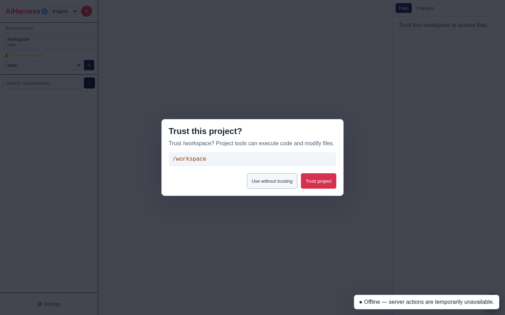

1. choisissez ou confirmez le workspace dans la barre latérale ;
2. approuvez explicitement le projet après avoir vérifié son chemin ;
3. cliquez sur **+** pour ouvrir un brouillon local ;
4. conservez le provider **Mock** dans **Settings** ;
5. envoyez `Hello` : la session n’est créée sur le serveur qu’à cet instant.

### Configurer le Web

La page **Settings** permet de :

- sélectionner le provider actif, enregistrer une clé auprès du serveur et suivre connexion/usage ;
- lancer un OAuth Device Flow configuré, puis reconnecter ou déconnecter le provider sans exposer son token ;
- créer, tester et supprimer des providers compatibles et des modèles personnalisés, puis importer les modèles annoncés ;
- administrer le catalogue publié ou découvert, ses capacités/prix, son activation et les valeurs par défaut globales/projet ;
- régler les presets et outils réellement disponibles, dont PowerShell sous Windows ;
- examiner les skills par portée, autoriser leur invocation et installer ou mettre à jour ceux d’un registre ;
- inspecter et modifier une configuration MCP expurgée, tester explicitement un serveur stdio/HTTP configuré, ou prévisualiser puis importer/remplacer une entrée collée vérifiée ;
- installer et administrer explicitement les packages/plugins globaux ou projet, leurs versions et leurs ressources ;
- configurer les profils de sous-agent et leur portée globale/projet, puis suivre les agents enfants ;
- conserver le transport historique SSE/WebSocket pour les anciens endpoints de chat ;
- choisir les thèmes System, Light, Dark, Mist, Rose ou Pine ;
- régler largeur du contenu, taille de police et ouverture du raisonnement ;
- activer séparément son, notifications navigateur, Web Push et actions sur la sélection ;
- restaurer ou masquer la barre latérale et l’explorateur ;
- reconfigurer les raccourcis clavier, détecter leurs conflits et revenir aux valeurs par défaut ;
- appliquer un Bearer token à l’onglet courant ou se déconnecter de la session Web ;
- consulter les versions Web/agent, vérifier explicitement la dernière release et ouvrir ses notes sans installation automatique.

Dépliez **Manage model catalogue** dans la section **Model** pour rechercher un modèle ou un provider, voir ses capacités de raisonnement, d’image et d’outils, puis activer une entrée, toutes les entrées ou aucune. **Refresh catalogue** relance la découverte côté serveur : les serveurs locaux compatibles OpenAI/Ollama sont interrogés via leur endpoint de modèles, puis fusionnés avec un catalogue publié minimal et le modèle configuré. Une panne de découverte conserve le dernier résultat valide et le catalogue publié reste disponible.

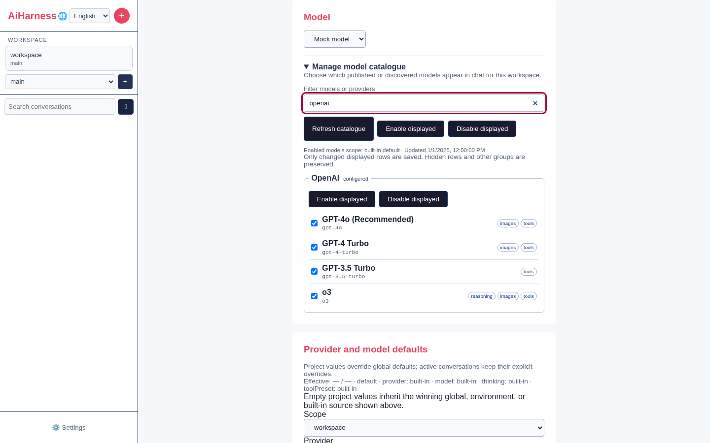

L'activation est enregistrée avec des identifiants qualifiés `provider:model`. Depuis un workspace, elle crée une portée projet ; sans projet, l'API utilise la portée globale. La provenance est affichée dans le panneau. Les modèles désactivés ou indisponibles restent visibles pour l'administration mais disparaissent des suggestions du sélecteur de chat. Seuls les modèles activés **et** disponibles du provider courant y sont proposés. Sous authentification, la consultation requiert un accès utilisateur et toute modification la capacité administrateur `configuration`.

Pour un provider local, Azure, Vertex ou Bedrock, préférez les variables d’environnement du serveur, car elles portent aussi l’URL, le projet, la région ou le modèle nécessaires. Le catalogue et son cache ne contiennent ni clé, ni header d’authentification, ni autre credential.

#### Authentification, providers et modèles personnalisés

**Provider lifecycle** affiche la méthode effective (`environment`, clé, OAuth ou aucune), l’usage cumulé et les actions réellement disponibles. Le bouton OAuth ouvre un Device Flow ; le code est conservé côté serveur, le navigateur ne reçoit jamais l’access token. Configurez chaque intégration avant le démarrage :

```bash
export AI_HARNESS_OAUTH_OPENAI_DEVICE_URL='https://.../device'
export AI_HARNESS_OAUTH_OPENAI_TOKEN_URL='https://.../token'
export AI_HARNESS_OAUTH_OPENAI_CLIENT_ID='...'
export AI_HARNESS_OAUTH_OPENAI_SCOPE='...' # facultatif
```

Remplacez `OPENAI` par le nom du provider en majuscules. Les endpoints OAuth doivent être HTTPS, sans credentials intégrés. L’annulation invalide le Device Flow local ; reconnecter remplace le token précédent.

**Manage compatible providers** accepte un identifiant stable, un nom, une URL HTTP(S) sans userinfo/query/fragment, le dialecte OpenAI Chat Completions, OpenAI Responses, Anthropic Messages ou Google Generative Language, une clé facultative et des headers JSON. Vous pouvez tester la connexion, importer les modèles annoncés, déconnecter ou supprimer l’entrée. Ce formulaire navigateur ne fournit ni ne lance aucune commande de credential ; seul un réglage `providerApiKeyCommands` de confiance, détenu par l’opérateur, peut en exécuter une sur l’hôte.

**Custom models** permet d’ajouter à n’importe quel provider un ID et un nom, les capacités raisonnement/images/outils, fenêtre de contexte, sortie maximale, prix par million de tokens entrée/sortie/cache et paramètres de compatibilité JSON. Les métadonnées personnalisées prévalent sur le catalogue publié. Un test de connexion vérifie explicitement l’entrée ; un modèle sans tool calls désactive les outils pour le run.

**Defaults and scope** règle provider, modèle et preset d’outils au niveau global ou projet. Une valeur vide signifie « hériter » ; la valeur effective et sa provenance restent visibles. Une valeur imposée par l’environnement est verrouillée. **Tools** suit les mêmes portées, liste les outils réellement enregistrés et propose les presets `configured`, `chat-only`, `read-only`, `default` et `full`. PowerShell est indisponible hors Windows et désactivé par défaut même sous Windows.

Les métriques agrègent tous les tours provider, y compris les tours intermédiaires d’outils, compactions, titres et résumés. Elles distinguent entrée, sortie, lecture/écriture de cache et coût calculé avec les prix personnalisés ou publiés. Le serveur les restaure depuis `usage-metrics.json` au redémarrage.

La section **Skills** regroupe les documents découverts sous **Project**, **Global**, **Configured paths** et **Packages**. Chaque ligne affiche le nom, la description, le fichier, la source, la version éventuelle et la confiance. Le filtre porte sur le nom, la description et la source ; **Refresh skills** relance une découverte bornée. Les sources serveur sont `~/.agents/skills`, le répertoire de données `skills/` et `packages/`, les chemins explicitement listés dans `AI_HARNESS_SKILL_PATHS`, puis `.agents/skills` et `.ai-harness/skills` du workspace.

Une case cochée autorise le modèle à charger ce skill avec l’outil en lecture seule `load_skill` ; elle ne lance ni n’installe rien. Le réglage est écrit au niveau du projet courant, ou globalement lorsqu’aucun projet n’est fourni, et sa provenance est affichée. Un skill projet reste verrouillé et non invocable avant l’approbation explicite du workspace, même si son frontmatter l’active par défaut. En cas de noms identiques, l’invocation privilégie projet, chemin configuré, package puis global. Le navigateur ne reçoit jamais le corps d’instructions : seules les métadonnées du catalogue y transitent. Sous authentification, la lecture est accessible au rôle utilisateur, mais la modification exige la capacité `configuration`.

Définissez `AI_HARNESS_SKILL_REGISTRY_URL` vers un index HTTPS pour ouvrir **Skill registry**. Le panneau recherche les métadonnées, installe en portée globale ou projet, signale les versions plus récentes et applique une mise à jour ou toutes celles de la portée. Chaque entrée du registre doit fournir un `downloadUrl` HTTPS et le SHA-256 du `SKILL.md`. Le serveur limite index et documents, refuse redirections, credentials intégrés et liens symboliques, vérifie le digest puis remplace atomiquement la version installée. Une installation projet exige un workspace approuvé et recharge le catalogue sans transmettre les instructions au navigateur.

### Mode Code

**Outils et préréglages › Sandbox du mode Code** affiche un auto-test QuickJS mis en cache. Lire les réglages n’exécute aucun script. Choisissez **Automatique** pour les outils indirects éligibles ou **Toujours actif**, `on` (outils normaux et helper) ou `only` (outils imbriquables via le helper), et un budget de déclarations intégrées de 0 à 3000 tokens estimés. Enregistrez au niveau Global ou Projet ; le projet prime sur le global. Listes autorisées, exclusions et préréglages restent prioritaires : chat seul désactive le helper, lecture seule limite les appels imbriqués, et les built-ins indisponibles ou non sélectionnés affichent une raison. Un auto-test échoué désactive l’activation.

Pour activer le helper en CLI/JSON/RPC, incluez `codemode` et les noms des outils imbriqués autorisés dans `--tools` ou `defaultTools` ; les réglages approuvés `codemode.mode` et `codemode.inlineBudget` adaptent sa présentation. Le modèle lui transmet un corps JavaScript async, par exemple :

```javascript
text(await tools.read({ path: "README.md" }));
store("cursor", { page: 2 });
```

Les outils imbriqués renvoient du texte expurgé. Les scripts disposent de `Promise.allSettled`, `ALL_TOOLS`, `searchTools`, `describeTool`, `describeNamespace`, `text`, console, `return`, `exit` et `store`/`load` JSON. Le store suit la branche active de session et publie uniquement après succès ; échec ou annulation ne publient aucune nouvelle valeur. Ce n’est pas un coffre de secrets.

La VM QuickJS jetable n’a aucun accès ambiant à Node, aux fichiers, au réseau ou aux timers. Limites : 10 secondes préparation comprise, VM de 32 Mio, pile de 256 Kio, 10 000 interruptions, 64 opérations de pont, quatre appels simultanés, source/entrée/sortie de 64 Kio et résultats imbriqués cumulés de 256 Kio. Le store accepte 128 clés, 64 Kio par valeur et 256 Kio au total. Les modèles classifier/image ne sont pas pris en charge.

**Découverte ne vaut pas autorisation.** Outils cachés, contrôles model-only et mode Code récursif ne sont pas imbriquables. Chaque appel revérifie les outils éligibles courants, y compris après attente et pour les annotations MCP de lecture seule. Serveurs MCP et extensions approuvées gardent leurs privilèges réels ; les appels antérieurs ne sont pas annulés lorsqu’un script échoue. Utilisez le moindre privilège et protégez l’hôte indépendamment.

### Configuration MCP

La section **Serveurs MCP** des réglages est un inventaire expurgé avec un Test de connexion ponctuel explicite, modification intégrale, activation, désactivation, exposition des outils, suppression et restauration locales. L’inventaire lui-même ne démarre aucune connexion ; un hôte séparé par session connecte les serveurs actifs éligibles juste avant un prompt agent. Elle lit le fichier global `<répertoire-de-données>/mcp.json` (par défaut `~/.ai-harness/mcp.json`) et, uniquement après une autorisation enregistrée exacte ou héritée, `<workspace>/.ai-harness/mcp.json`. Le statut implicitement sûr d’un workspace vide ne suffit pas, à lui seul, à ouvrir, tester ou modifier normalement un fichier projet. Avant approbation, le panneau signale seulement l’existence du fichier : il ne lit ni noms de serveurs ni valeurs. Un refus explicite ou un registre de confiance indisponible le maintient également verrouillé.

Choisissez **Tester** sur une ligne valide, même désactivée, uniquement si vous souhaitez exécuter ou contacter le serveur configuré. Le navigateur envoie sa portée, son nom et le workspace courant, jamais sa configuration ; Core relit le fichier et la confiance, résout les valeurs d’environnement/header/commande prises en charge de cette entrée, puis démarre une fois son processus stdio ou contacte son URL HTTP. Requêtes, durée totale, pagination des capacités, sorties et fermeture sont bornées, et le transport est fermé après succès, échec, expiration ou arrêt du serveur. Le rapport indique identité et dossier de travail, compte outils/ressources/modèles/prompts et liste des noms d’outils bornés, descriptions sur une ligne, **indications** de lecture seule et exposition effective. Secrets configurés/résolus, parties sensibles des cibles, stderr et erreurs sont masqués et bornés avant d’atteindre le navigateur. Un challenge d’autorisation indique **Authentification requise** sans lancer OAuth ; utilisez l’action **Se connecter** distincte ci-dessous. Le Test n’invoque aucun outil, ne persiste aucun credential et n’active pas le serveur pour les agents. Modifier la configuration efface son ancien statut en mémoire.

Dépliez **Coller et prévisualiser un serveur** pour examiner et éventuellement importer une URL, une commande directe, une commande cliente `mcp add` prise en charge, un lien d’installation Cursor/VS Code/Visual Studio/Copilot ou du JSON/JSONC. Collez le texte original puis choisissez **Prévisualiser**. Le mode **étranger** par défaut traite les valeurs `$...` et `!` étrangères comme des littéraux et les échappe dans la forme proposée ; les formes de variables explicites des commandes shell/client prises en charge restent des références. Cochez **Interpréter les valeurs résolues selon la syntaxe AiHarness** seulement si le texte utilise volontairement la syntaxe AiHarness `${VARIABLE}`, `$VARIABLE` ou `!commande`. Changer le texte, le mode ou le workspace invalide un résultat obsolète.

Les cartes d’aperçu n’affichent que cible masquée, champs structurels, noms de variables, notes fixes et éligibilité **Globale**/**Projet**. Elles ne répètent jamais les valeurs env/header/OAuth, arguments, secrets littéraux, extraits source ou une configuration brute réutilisable. Choisissez **Configurer l’import global** ou **Configurer l’import projet** pour ouvrir la modale de complétion d’une entrée. Saisissez uniquement les champs indiqués, remplacez facultativement les secrets collés pris en charge par des noms de variables hôte, puis vérifiez chaque confirmation. Un secret littéral restant ne peut être stocké globalement qu’après approbation explicite et reste refusé dans la configuration projet ; une variable hôte disponible employée par un header distant ou un secret OAuth exige une confirmation liée à son nom. Si le projet sélectionné n’a ni décision enregistrée ni ressource exigeant la confiance et que son analyse bornée de portée est sûre, la portée projet vous demande plutôt de confirmer que vous approuvez ce dossier neuf et souhaitez créer sa première ressource protégée. Racines système/personnelles/de données, conteneurs d’un autre projet connu ou imbriqué non approuvé, scans en échec, décisions explicites et dossiers modifiés depuis l’aperçu ne sont pas éligibles. Les références à `AI_HARNESS_AUTH_TOKEN`, `AI_HARNESS_ADMIN_TOKEN` ou `AI_HARNESS_MASTER_KEY` bloquent toutes les portées. Les références ne sont acceptées que dans les valeurs env, headers et `oauth.clientSecret`. L’aperçu ne lit que les **noms** des variables hôte, jamais leurs valeurs, et n’effectue ni écriture, processus, réseau, OAuth ni accès à un magasin de credentials. Il accepte au plus 256 Kio, 20 serveurs, 128 champs, 64 niveaux et 256 mots shell ; opérateurs, substitutions, commandes multiples, `sh -c`, `cmd /c` et `pwsh -Command` sont refusés.

**Enregistrer atomiquement** renvoie le collage original, l’index de l’entrée, la portée/le nom et les choix bornés de complétion/confirmation. Core reparcourt ce texte au lieu de faire confiance à une configuration construite par le navigateur, puis ajoute exactement une entrée sous la révision cible et le verrou partagé. Pour le cas explicitement confirmé d’un projet neuf, Core revérifie sous le verrou de confiance l’identité du dossier, ses ressources, les décisions les plus proches et sa portée large/imbriquée, enregistre une autorisation exacte, revérifie après acquisition du verrou MCP, puis crée le premier fichier. Si l’écriture échoue, il ne retire que l’autorisation introduite par cette transaction ; même un échec de rollback déclenche une recharge autoritative de l’inventaire et de la confiance du workspace, sans mise à jour optimiste du navigateur. Un succès efface le collage et adopte un inventaire expurgé frais. Un échec n’affiche qu’un message localisé générique, supprime les contrôles d’import obsolètes et recharge l’état canonique. Coller un secret le place néanmoins dans le textarea du navigateur et dans la requête ; utilisez le minimum nécessaire et effacez vous-même un collage annulé.

Choisissez **Modifier** sur une ligne valide pour remplacer cette seule entrée depuis une URL, commande ou configuration complète collée. L’éditeur reste fixé à la portée et à la révision de la ligne, réutilise l’aperçu expurgé, la complétion, les restrictions de références et confirmations de secrets de l’import, puis renvoie le texte original à Core. Il ne charge jamais dans le formulaire les valeurs env/header/OAuth courantes ni aucun autre littéral masqué. Incluez tous les champs à conserver : les champs omis — y compris anciens secrets, activation et métadonnée d’exposition — sont supprimés ou reprennent leur valeur par défaut. Vous pouvez renommer l’entrée si ce nom n’existe pas déjà dans la même portée. **Remplacer atomiquement** conserve les clés racine, serveurs frères, style et permissions du fichier ; un remplacement strictement inchangé ne réécrit rien. Annulation, succès et échec restaurent le focus clavier, et tout échec recharge l’inventaire canonique avant une nouvelle modification.

La racine JSON/JSONC acceptée contient un `"version": 1` facultatif et un objet `mcpServers`. Les commentaires et virgules finales sont acceptés. Chaque entrée utilise exactement une `url` HTTP(S) ou une `command` non vide, avec facultativement des chaînes `args`, `env`, `headers`, `cwd`, `description`, un booléen `enabled`, une `exposure` parmi `direct|codemode|deferred|hidden`, des dérogations facultatives `toolExposure` indexées par nom distant exact d’outil et les métadonnées OAuth prises en charge. Exemple :

```json
{
  "version": 1,
  "mcpServers": {
    "documentation": {
      "url": "https://docs.example.test/mcp",
      "headers": { "Authorization": "${DOCS_TOKEN}" },
      "exposure": "deferred"
    },
    "outils-locaux": {
      "command": "npx",
      "args": ["-y", "@example/mcp-server"],
      "env": { "MCP_TOKEN": "${MCP_TOKEN}" }
    }
  }
}
```

L’inventaire, l’aperçu d’un collage, son écriture d’import et les actions locales ne développent jamais `$VARIABLE`, n’exécutent aucune `!commande`, ne lancent aucun processus, ne contactent aucune URL, n’initialisent pas OAuth et ne créent pas de credentials. Un **Test** explicite résout l’entrée fraîchement sélectionnée et se connecte une fois sous ses limites ; il n’invoque aucun outil et n’écrit aucun credential. OAuth explicite et l’hôte de session pré-prompt sont des voies d’exécution séparées. Le navigateur reçoit sinon les **noms** d’environnement/headers, les noms de variables référencées et les noms des champs adossés à une commande, jamais leurs valeurs. Les chemins exécutables et arguments littéraux sont expurgés ; les credentials, le chemin, la query et le fragment d’une URL sont masqués, tandis que l’hôte de destination reste visible pour vérification. Les caractères de contrôle cachés sont échappés, les erreurs de syntaxe ne citent jamais la source et le masquage global/projet est explicite. **Configuré** signifie qu’une entrée a passé la validation ; un rapport de Test récent ou le statut volatil du runtime de session peuvent indiquer **Connecté**.

Utilisez **Modifier**, **Activer**/**Désactiver** sur une ligne, ou **Tout activer**/**Tout désactiver**, pour modifier les entrées valides. Une action groupée forme une seule transaction de fichier bornée, jamais une série de requêtes navigateur. Le sélecteur **Exposition des outils** d’une ligne valide écrit exactement `direct`, `codemode`, `deferred` ou `hidden` ; il ne modifie que les métadonnées du fichier, sans charger d’outil, connecter le serveur ni indiquer un runtime actif. **Supprimer** sur une ligne valide ouvre une confirmation ; les entrées invalides restent en lecture seule. Après succès, **Restaurer** reste disponible pendant 60 secondes. L’entrée littérale supprimée reste uniquement dans une mémoire serveur bornée ; le navigateur ne reçoit qu’un token aléatoire à usage unique. La restauration projet revérifie l’autorisation enregistrée. Sous authentification, l’inventaire demande `workspace:read` et toute action la capacité administrateur `configuration`.

Les outils **Cachés** ne sont ni déclarés, ni découvrables, ni appelables depuis un script. Un serveur entièrement caché ne démarre pas pour les prompts agent, sauf si une dérogation non cachée le rend éligible. Dépliez **Surcharges d’exposition par outil** après un Test explicite (ou pour des dérogations existantes) pour régler un nom distant exact. `toolExposure` remplace le défaut serveur ; supprimez une dérogation du fichier ou par modification intégrale pour rétablir l’héritage. Enregistrer l’exposition invalide l’ancien rapport Test/runtime ; relancez Tester si nécessaire. Dans le Chat Web, `/mcp` seul ouvre localement cette section sans envoyer de prompt au provider.

Chaque import, remplacement ou action locale compare la révision opaque du dernier inventaire. Core verrouille les writers coopérants, relit les octets courants, refuse les cibles obsolètes, malformées, liées ou non ordinaires, puis remplace atomiquement le fichier. Les clés inconnues sont conservées ; le JSONC est normalisé en JSON, avec indentation et style LF/CRLF conservés ainsi qu’une fin de ligne finale. Les écritures globales utilisent le mode `0600` ; le mode projet existant est conservé et un nouveau fichier projet utilise `0644`. Une requête expirée peut avoir été enregistrée : le panneau recharge donc l’inventaire au lieu d’annoncer un rollback.

Les deux fichiers restent limités à 1 Mio, 64 niveaux d'imbrication et 200 serveurs ; chaque import ajoute une entrée sélectionnée, chaque modification remplace une entrée valide et l'activation groupée est limitée à 100 noms uniques. Les entrées invalides et problèmes de fichier restent visibles au moyen de diagnostics sans valeurs. Les agents CLI, RPC et Web partagent l'hôte MCP persistant. Les outils directs sont déclarés avant le prompt ; les outils indirects exposent initialement leurs métadonnées. Les résultats deferred sont déclarés au tour modèle suivant après découverte, tandis que les outils `codemode` restent réservés aux scripts même après recherche. Les sessions en lecture seule ne conservent que les outils actuellement annotés `readOnlyHint: true`. Annotation, découverte, confiance projet et authentification OAuth ne sont ni sandbox ni approbation par appel. Les processus MCP et outils distants gardent leurs privilèges réels : utilisez des serveurs et credentials de moindre privilège. Renforcez les permissions des fichiers projet créés manuellement s'ils contiennent des credentials littéraux ; préférez les références d'environnement et traitez Tester comme l'exécution d'une configuration approuvée.

#### Connexion MCP OAuth

L’administration CLI utilise le même flux Core :

```bash
ai-harness mcp login documentation --no-open --timeout 120
ai-harness mcp logout documentation
ai-harness mcp exposure documentation hidden --tool search_docs
```

La connexion exige `AI_HARNESS_MASTER_KEY` et un répertoire agent indépendant approuvé. Elle ouvre le navigateur par défaut ; `--no-open` affiche les adresses d’autorisation/callback sur stderr. Approuvez dans le navigateur, ou collez l’adresse complète après redirection dans un terminal interactif. `--timeout` accepte 1–300 secondes (300 par défaut). Ctrl+C annule et ferme l’écouteur ; succès retourne 0, expiration/échec 1 et annulation 130. `--scope global|project` choisit la configuration ; le projet exige toujours une confiance enregistrée. La déconnexion retire les credentials locaux, pas les jetons de l’issuer. Les prompts CLI/RPC ordinaires réutilisent ou rafraîchissent uniquement les credentials stockés sans commencer de connexion.

Pour un serveur HTTP éligible sans header `Authorization` propre, choisissez **Se connecter**, puis **Ouvrir la page d’autorisation**. L’issuer utilise découverte, client configuré ou enregistrement dynamique et PKCE S256. Revenez aux réglages après approbation : ils suivent un flux détaché limité à cinq minutes. Le callback écoute uniquement sur `127.0.0.1` de l’hôte AiHarness ; si votre navigateur utilise une autre machine ou ne peut pas joindre cet hôte, collez l’**adresse complète après redirection** dans le panneau. Conservez port, chemin, state et code ; ne collez jamais un jeton d’accès. **Annuler la connexion** ferme l’écouteur et arrête le flux. Le champ de collage ne prend pas automatiquement le focus.

**Se déconnecter** supprime les credentials locaux, bloque les écritures tardives de refresh, ferme les sessions MCP locales correspondantes et annule les requêtes OAuth passives. Cela ne révoque pas le jeton chez l’issuer : utilisez son interface d’administration pour la révocation distante. Les connexions agent ordinaires réutilisent/rafraîchissent uniquement les credentials stockés ; elles n’ouvrent jamais de navigateur et ne commencent aucun enregistrement interactif. Renommer un serveur ou changer son URL normalisée sélectionne une autre identité de credentials. Une configuration désactivée, modifiée ou devenue non approuvée ne peut pas terminer l’autorisation.

L’opérateur doit fournir une `AI_HARNESS_MASTER_KEY` stable et un stockage privé accessible en écriture `<répertoire-de-données>/credentials.enc` (le CLI utilise le répertoire agent résolu). Sans stockage chiffré durable, connexion/déconnexion échouent fermées ; ne placez ni clé maître ni jetons dans `mcp.json`. Les métadonnées OAuth `clientId`, `clientSecret` référencé par environnement et `scopes` sont prises en charge. L’autorisation demande la capacité administrateur `configuration`. Jetons, refresh tokens, secrets clients et vérificateurs PKCE restent côté serveur, jamais dans le stockage navigateur, les sessions ou les réponses de statut. Pour diagnostiquer authentification requise, stockage indisponible, redirection refusée, configuration modifiée et vérification échouée, utilisez l’état fixe du panneau sans copier de credentials bruts dans les logs. Les tests utilisent un véritable issuer loopback jetable, sans credentials de production.

### Packages et plugins

Le CLI et le Web utilisent un unique service Core et le même `plugins.json` : validation des sources, inventaire, confiance, mises à jour et persistance ne sont pas dupliqués. La section **Plugins and packages** regroupe les packages **Project** et **Global**, puis inventorie séparément les extensions autonomes de `.ai-harness/extensions/` et du répertoire de données. L’installation reste toujours une action explicite ; afficher ou rafraîchir le catalogue ne contacte aucun registre et ne modifie aucun fichier. Trois formes de source strictes sont acceptées :

```text
npm:@scope/package@^2.0.0
git:https://github.com/organisation/depot.git#branche-ou-tag
/chemin/absolu/vers/un-package-ou-une-extension.js
```

Une source Git doit utiliser HTTPS, sans credentials, query string ni port personnalisé. Les hôtes permis sont `github.com`, `gitlab.com` et `bitbucket.org` par défaut ; `AI_HARNESS_PLUGIN_GIT_HOSTS=git.example.com,github.com` remplace cette liste. Un chemin local doit exister dans la racine active autorisée. L’API Web exige un chemin absolu ; le CLI accepte aussi `./` et `../` relativement à son répertoire canonique de démarrage. Installer, configurer, activer, mettre à jour ou charger un package de portée projet exige l’approbation explicite du workspace ou une décision CLI `--approve` limitée au processus ; sa désactivation et sa suppression restent disponibles pour un nettoyage sûr.

Le CLI termine avant le démarrage de l’agent pour administrer les packages. `ai-harness package --help` décrit toutes les actions ; `install`, `remove`/`uninstall`, `update`, `list` et `config` sont des alias directs :

```bash
ai-harness package install npm:@scope/package@^2 --global
ai-harness package install ./package-workspace --project --approve
ai-harness package list --json
ai-harness package configure @scope/package --extensions='extensions/*.mjs,!extensions/unsafe.mjs' --themes=
ai-harness package check @scope/package
ai-harness package update @scope/package
ai-harness package disable @scope/package
ai-harness package reload
ai-harness package remove @scope/package
```

La configuration ne peut que restreindre les extensions, skills, prompts et thèmes déjà déclarés par le package. Les globs séparés par des virgules acceptent les exclusions `!glob`, tandis que `+chemin` et `-chemin` sont une inclusion/exclusion exacte ; une valeur vide désactive le type et `--reset` restaure le manifeste.

Les installations npm et Git sont copiées dans `~/.ai-harness/plugins/installed/` par staging puis renommage atomique. Les scripts de cycle de vie npm sont désactivés, les clones Git sont superficiels et les dépendances de développement sont omises. Cela réduit l’exposition lors de l’installation, sans rendre un package tiers digne de confiance : vérifiez toujours sa source. Une extension exécutable activée s’exécute comme code Node de confiance dans le processus CLI ou serveur actif, sans sandbox de sécurité. Supprimer une source locale retire uniquement sa configuration AiHarness, jamais le dossier d’origine.

Chaque fiche affiche version, état, source et nombres d’extensions, skills, prompts et thèmes. **Disable/Enable** conserve le package mais retire ou restaure ses ressources ; **Remove** demande confirmation. **Check** et **Check all** sont les seules actions qui interrogent npm ou le dépôt Git. Une mise à jour est elle aussi volontaire, préparée hors de l’installation active, puis remplacée avec rollback si l’écriture d’état ou l’installation échoue. Les sources locales sont relues directement et n’ont pas de vérification distante.

Chaque groupe Projet ou Global propose également **Enable all** et **Disable all**. Une action groupée envoie une seule requête bornée et produit au plus une écriture atomique de l’état, au lieu d’une requête par fiche. Elle ne modifie que l’activation, conserve les filtres de ressources de chaque package et indique les lignes modifiées, inchangées ou refusées. Un projet non approuvé peut toujours être désactivé pour un nettoyage sûr, mais pas activé. Lorsque des extensions exécutables ont changé, un avertissement reste visible jusqu’au succès de **Reload resources**. Le nettoyage sûr d’un projet non approuvé affiche ce même avertissement par prudence, sans relire les fichiers du package.

**Refresh catalogue** refait seulement l’inventaire borné. **Reload resources** valide d’abord tous les packages actifs, puis publie une génération atomique ; en cas d’erreur, l’ancienne génération reste active. Si une conversation persistée est ouverte, son identifiant lie le reload au même workspace. Les skills et prompts des packages activés deviennent disponibles dans leurs catalogues, et `load_skill` peut charger les skills autorisés. Les extensions exécutables activées sont ensuite chargées dans une génération gérée : leurs commandes, providers, outils, panneaux texte, hooks et listeners remplacent ensemble l’ancienne génération, sans conserver de handler périmé. Un changement vers un workspace dont la génération est invalide retire les handlers de l’ancien projet.

Le catalogue transmis au navigateur et la sortie CLI `--json` ne contiennent que des métadonnées nettoyées : jamais le corps d’un skill ou prompt, le code d’une extension, des credentials ni stdout/stderr de commande. La découverte et le chargeur sont bornés, refusent les liens symboliques et les modules dépassant 5 Mio, et masquent les ressources projet lorsqu’un workspace perd sa confiance. Les mutations d’état sont sérialisées entre les processus CLI/Server et utilisent des fichiers atomiques réservés au propriétaire. Sous authentification, les mutations Web, vérifications, mises à jour et reloads exigent la capacité administrateur `packages`.

### Extensions Web et interactions

Les extensions globales du répertoire de données, celles de `.ai-harness/extensions/` dans un projet approuvé et celles des packages actifs alimentent la palette `/` et les panneaux de conversation après **Reload resources** ou `/reload`. Le reload prépare toute la génération avant de la publier ; une erreur dans le même workspace conserve la génération valide précédente et affiche le diagnostic.

Une extension peut publier un widget texte, une notice ou demander une interaction `confirm`, `input`, `select`, `editor` ou `custom`. Les formulaires custom restent déclaratifs : champs texte, sélection, case à cocher et boutons, jamais HTML ou accès DOM arbitraire. Le dialogue piège le focus, accepte `Escape`, restaure le composer et renvoie une réponse structurée que le serveur revalide. Si l’onglet n’est pas visible, une demande d’interaction peut utiliser la catégorie Push **attention**. Une interaction nécessite toujours un run actif.

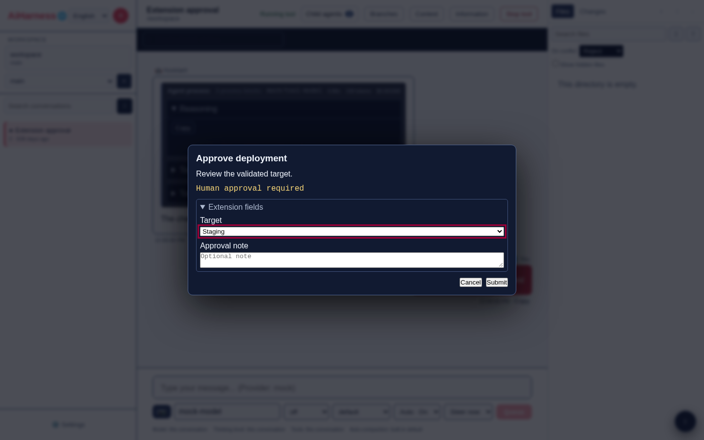

### Profils et agents enfants

La section **Sub-agents** active ou désactive le moteur intégré et fixe le nombre d’enfants simultanés (1 à 16, quatre par défaut). Choisissez **Project workspace** pour créer une surcharge du workspace courant ou **Global defaults** pour modifier la base commune. Les profils intégrés sont :

- **Explore** : inspection en lecture seule, contexte hérité, arrière-plan par défaut ;
- **General purpose** : tâche générale avec la politique d’outils du parent ;
- **Plan** : analyse en lecture seule, thinking élevé et attente synchrone par défaut.

Un profil personnalisé possède un ID stable (généré si le champ est vide), un nom, une description et des instructions. Les listes séparées par des virgules limitent les outils, skills et extensions ; une liste vide hérite de tout ce que le preset parent autorise. Le modèle et le thinking vides héritent aussi du parent. Vous pouvez limiter les tours, transmettre ou non un extrait de contexte, choisir l’arrière-plan, activer, modifier, dupliquer ou supprimer un profil personnalisé. Un profil intégré reste modifiable et duplicable, mais pas supprimable. Les mutations de profils exigent la capacité administrateur `configuration`.

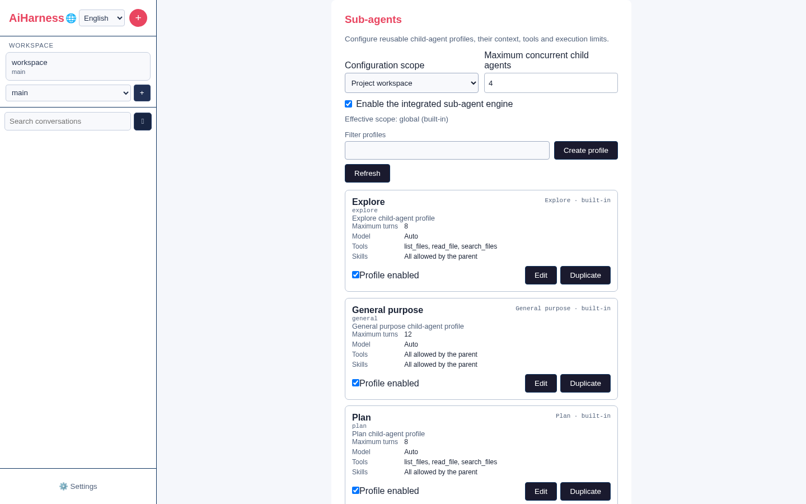

Pendant un run agent, le modèle peut appeler l’outil `spawn_subagent` avec un ID de profil, une tâche bornée et éventuellement `background`. Le serveur exige un workspace approuvé, limite la délégation à trois niveaux et transmet au plus 40 messages/120 000 caractères. Chaque enfant devient une session persistée reliée à son parent et respecte ses allowlists d’outils, skills et extensions. Un enfant synchrone rend directement son résultat au parent ; un enfant en arrière-plan continue après la fin ou la navigation de la conversation parente.

Le bouton **Child agents** dans l’en-tête de conversation affiche le nombre de runs, leur tâche, état, phase et progression. Un badge signale un run terminé, en échec ou arrêté qui demande de l’attention. Ouvrir le panneau acquitte le badge ; **Open details** ouvre la session enfant, **Back to parent agent** revient au parent et **Stop child agent** annule un run actif. Une notification interne reste visible dans le centre de statuts à la fin. Les sessions enfants survivent à un redémarrage, mais la liste de progression des runs déjà terminés est conservée uniquement pendant le processus serveur courant.

Le bouton **Apply** conserve un Bearer token de compatibilité dans `sessionStorage`, isolé par onglet. Lorsque le serveur exige une authentification, la page de connexion échange plutôt ce token contre un cookie de session opaque `HttpOnly` : le secret n’est alors pas lisible par JavaScript. Les préférences versionnées et le choix du transport historique sont conservés dans `localStorage`, jamais les credentials provider.

### Installation PWA et mode hors ligne

Le bundle de production publie un manifeste installable. Sur un navigateur compatible, **Install app** ajoute AiHarness comme application autonome. Le service worker met seulement en cache le shell et les ressources statiques : les routes `/api` et les données de conversation ne sont jamais placées dans son cache.

Hors ligne, le shell signale que les actions serveur sont indisponibles et propose de réessayer. Les agents déjà lancés continuent côté serveur ; leur état est resynchronisé au retour du réseau. Lorsqu’un nouveau bundle est prêt, une bannière permet de choisir quand l’activer plutôt que de recharger silencieusement une conversation active.

Dans les préférences, **Web Push** demande la permission uniquement lorsque vous activez explicitement l’option. Les catégories **completion** et **attention** sont indépendantes du son et des notifications locales. Un clic ouvre la conversation concernée ; un tag évite les doublons et le service worker n’affiche rien lorsqu’un client AiHarness visible traite déjà l’événement. Cette fonction couvre notamment une PWA installée sur l’écran d’accueil iOS.

Le serveur génère ses clés VAPID. Avec `AI_HARNESS_MASTER_KEY`, clés et souscriptions sont conservées chiffrées dans `push.enc` ; sans cette clé elles sont volatiles et le navigateur doit se réinscrire après une rotation/redémarrage. `AI_HARNESS_VAPID_SUBJECT` peut définir le contact VAPID, par exemple `mailto:admin@example.com`. Hors tests, seuls des endpoints HTTPS résolus vers des adresses publiques sont acceptés.

La section **À propos** vérifie en arrière-plan la dernière release publiée, avec un timeout court et un cache serveur de six heures. Une release disponible n’est jamais installée automatiquement : son lien et ses notes sont affichés comme texte. Un échec reste discret dans un panneau de diagnostic replié. Pour une installation isolée, désactivez cet appel avec `AI_HARNESS_DISABLE_UPDATE_CHECK=1` ; `AI_HARNESS_UPDATE_CHECK_URL` peut pointer vers un endpoint de métadonnées compatible GitHub Releases.

### Langue de l’interface

L’interface est fournie en anglais et en français. Lors de la première visite,
AiHarness sélectionne la première langue compatible déclarée par le navigateur,
puis revient à l’anglais si nécessaire. Le sélecteur 🌐 dans l’en-tête de la
barre latérale permet de changer de langue immédiatement. Ce choix est conservé
dans `localStorage` sous la clé `ai-harness-locale`.

Pour ajouter un paquet de traduction ou modifier un texte d'interface, consultez
le [guide d'internationalisation](../../contributors/fr/i18n.md).

### Workspaces, confiance et worktrees

Le bouton de workspace ouvre un navigateur de répertoires. Il accepte un chemin absolu ou `~`, permet de remonter au parent et mémorise les projets récents. Une liste affiche au plus 500 entrées et signale lorsqu’il faut poursuivre en saisissant un chemin. **Nouveau dossier** ouvre un dialogue avec focus contraint qui crée exactement un enfant direct, puis navigue dans son chemin canonique ; séparateurs, traversées et sorties des racines configurées sont refusés. Le paramètre `?cwd=` rend le workspace partageable sans créer de conversation.

Lorsque le serveur est ouvert localement sur macOS, Windows ou Linux pris en charge, le bouton adjacent **Ouvrir le workspace dans le gestionnaire de fichiers** demande au bureau de l’hôte d’afficher le workspace canonique. Il est volontairement absent pour une requête distante ou un hôte non pris en charge. La route est réservée à l’administrateur, limitée au loopback et n’invoque jamais de shell.

L’approbation est volontaire : vérifiez le chemin canonique affiché avant de confirmer. Le Web et le CLI utilisent le même registre Core : une autorisation ou un refus peut être exact ou hérité du dossier parent le plus proche. Une révocation par l’API Web enregistre un refus exact afin qu’une ancienne autorisation parente ne réactive pas silencieusement le projet. Une autorisation active les ressources, outils, commandes et écritures dans ce projet. Un chemin hors des racines autorisées ou un lien symbolique sortant est refusé.

Dans un dépôt Git, le sélecteur affiche la branche et les worktrees. Le bouton **+** adjacent permet de créer un worktree depuis une branche existante ou une nouvelle branche. La suppression d’un worktree demande confirmation. Si Git détecte des modifications locales, AiHarness le conserve et demande une seconde confirmation de forçage avant de réessayer avec l’option explicite. Les agents déjà lancés restent liés au cwd avec lequel ils ont démarré. Une bascule vide immédiatement les résultats de recherche et l’explorer devenus obsolètes, démonte les surfaces PTY de l’ancien cwd puis restaure séparément brouillons, provider/modèles, skills, plugins, profils de sous-agent, confiance et onglets du workspace cible.

Variables serveur utiles :

```bash
export AI_HARNESS_DEFAULT_CWD="$HOME/projets/mon-projet"
# Liste séparée par « : » sous Unix et « ; » sous Windows.
export AI_HARNESS_ALLOWED_ROOTS="$HOME/projets:/srv/sources"
export AI_HARNESS_DATA_DIR="$HOME/.ai-harness"
```

### Conversations et agent détaché

- **+** crée un brouillon local lié au workspace ; il n’est persisté qu’au premier envoi ;
- le texte, les images et les réglages du brouillon survivent à une navigation interne et à un rechargement complet dans la limite du cache borné de l’onglet ;
- la recherche de la barre latérale interroge titres et contenu, affiche un extrait et ouvre le message ciblé, même s’il faut charger une fenêtre d’historique plus ancienne ;
- les actions au survol permettent le renommage inline, la génération d’un titre court par le provider/modèle actif et la suppression confirmée. Si la conversation possède des branches imbriquées, une seconde confirmation en indique le nombre avant toute cascade ; les dates relatives, compteurs et indicateurs en cours/non lu/attention restent liés au bon workspace ;
- ouvrir la racine de l’application restaure la dernière conversation valide du workspace. Les flèches de l’en-tête passent à la conversation précédente ou suivante ; un lien vers une session supprimée affiche un état récupérable au lieu de relancer indéfiniment la requête ;
- **Branches**, **Info** et les actions sous un message donnent accès à l’arbre, à « Edit from here » et « New chat from here », ainsi qu’aux diagnostics complets (fichier/ID, cwd, branche, durée, compteurs, tokens/cache/coût/fenêtre) avec copie et export ;
- les conversations longues démarrent sur leurs 80 derniers messages. **Charger les messages précédents** ajoute une page sans déplacer le tour lu ; au-delà de 120 messages, seules les lignes visibles sont rendues, tout en conservant l’ancre de lecture. Une séparation explicite permet aussi de combler une plage omise autour d’un résultat de recherche ;
- **Carte de la conversation** affiche les rôles et un aperçu de chaque entrée chargée, saute précisément au tour choisi, rejoint les messages récents et propose le téléchargement de l’historique complet sans le charger dans le navigateur ;
- si vous remontez dans un historique long, les nouveaux messages ne déplacent pas la lecture : **Retour en bas** indique leur nombre et rejoint le dernier tour à la demande. La position, l’ancre visible et la distance au bas sont mémorisées par conversation/workspace, puis restaurées après navigation ou rechargement, y compris avec la virtualisation et les pages historiques ;
- l’agent continue côté serveur si l’onglet navigue ou perd sa connexion ; l’interface recharge le snapshot puis reprend les événements manquants ;
- le bouton d’arrêt précise la phase concernée : attente/réponse modèle, outil, commande shell ou compaction. L’annulation est propagée au provider ou à l’outil actif ;
- un échec avant le premier delta peut être retenté automatiquement sans créer de réponse assistant dupliquée. La tentative, le maximum et la dernière erreur restent visibles et sont restaurés par le snapshot après reconnexion.

La dernière vue est mise en cache dans le `sessionStorage` de l’onglet pour s’afficher avant la réconciliation réseau. Son schéma v2 migre les snapshots v1, expire après 24 h et reste borné à 2 Mio, trois sessions distantes et trois brouillons locaux par workspace. Il restaure la conversation ou le brouillon actif, le texte, les réglages, les petites pièces jointes et le choix provider/modèle ; les aperçus binaires sont évincés avant le texte si le budget est atteint. Aucune clé API n’y est écrite. Le serveur reste la source de vérité et remplace toute fenêtre distante dont la révision a changé. Le registre séparé des positions de lecture expire lui aussi après 24 h, conserve au plus 24 conversations par workspace et écrit de façon différée. Les préférences navigateur utilisent le schéma v3 et migrent automatiquement v1/v2 ; les onglets PTY restent isolés par workspace et tous ces stockages ont un repli sûr s’ils sont indisponibles.

Pendant un run, choisissez **steer** pour influencer le tour actif ou **follow-up** pour envoyer après sa réponse. Les deux files affichent leur contenu, sont restaurées après reconnexion et peuvent être vidées. Cliquez sur un message en file pour le rappeler dans le composer sans le retirer silencieusement.

Les quatre contrôles sous le composer règlent le modèle, le niveau de réflexion, le preset d’outils et l’auto-compaction. Chaque liste propose **Auto**, affiche la valeur héritée et indique sa provenance : valeur intégrée, globale, workspace (portée projet), conversation ou environnement. L’ordre de priorité est `intégrée < globale < workspace < conversation < environnement`. Une sélection explicite devient une surcharge persistée dans la conversation ; revenir à **Auto** supprime cette surcharge au lieu de recopier la valeur courante. Une valeur imposée par l’environnement est visible mais verrouillée. **Context** affiche le system prompt effectif et les schémas des outils réellement autorisés par le preset actif ; le panneau est actualisé après un changement ou `/reload`.

Les déploiements peuvent imposer les valeurs les plus prioritaires avec `AI_HARNESS_DEFAULT_MODEL`, `AI_HARNESS_DEFAULT_THINKING` (`off`, `low`, `medium`, `high`, `xhigh`, `max`), `AI_HARNESS_DEFAULT_TOOL_PRESET` (`configured`, `chat-only`, `read-only`, `default`, `full`) et `AI_HARNESS_AUTO_COMPACTION` (`true`/`false`, `on`/`off`, `1`/`0` ou `yes`/`no`).

### Composer, commandes et compaction

Le composer est multiligne et auto-dimensionné. Par défaut, `Entrée` envoie et `Maj+Entrée` ajoute une ligne. **Réglages → Apparence → Touche d’envoi** permet d’exiger plutôt `Ctrl+Entrée` ou `Cmd+Entrée`, de sorte qu’`Entrée` seule ajoute une ligne. Le choix est conservé dans les préférences du navigateur ; ni une composition IME active ni sa touche de confirmation sous Safari ne déclenchent l’envoi. `↑`/`↓` rappelle l’historique lorsque la saisie ne contient qu’une ligne.

Saisissez `@` pour rechercher de façon floue les fichiers **et** dossiers du workspace. La palette accepte `↑`/`↓`, `Entrée`, `Tab`, `Escape` et la souris. Elle filtre d’abord l’index local puis interroge le serveur si cet index était tronqué ; un chemin contenant des espaces est automatiquement inséré entre guillemets.

Commandes Web intégrées :

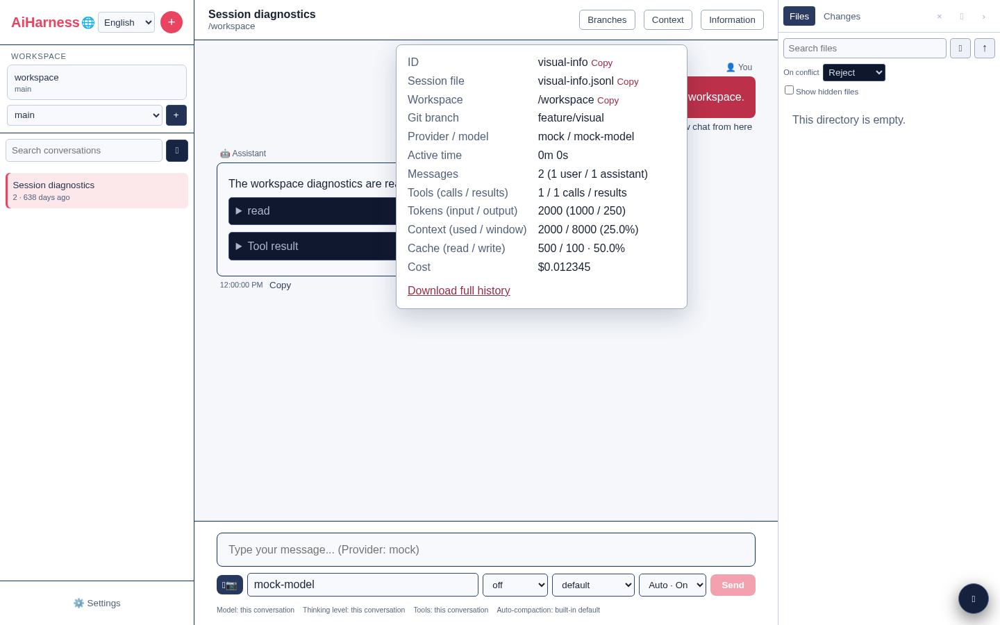

| Saisie | Effet |
|---|---|
| `/compact [instruction]` | résume l'ancien contexte et affiche les tokens avant/après |
| `/auto-compact [auto\|on\|off]` | consulte ou change la politique d'auto-compaction de la conversation |
| `/clone` | crée une copie indépendante |
| `/copy` | copie la dernière réponse assistant |
| `/name <titre>` | renomme la conversation |
| `/reload` | recharge les informations de session |
| `/stats` | ouvre le panneau d'informations |
| `!commande` | exécute dans le workspace et inclut la sortie dans le contexte modèle |
| `!!commande` | exécute et persiste la sortie, mais l'exclut du contexte modèle

Les commandes shell affichent sortie progressive, statut et code de sortie et peuvent être annulées. Elles restent distinctes du terminal PTY : `!` et `!!` produisent un résultat de session destiné au contexte, alors que le terminal est interactif et n’envoie pas automatiquement sa sortie au modèle.

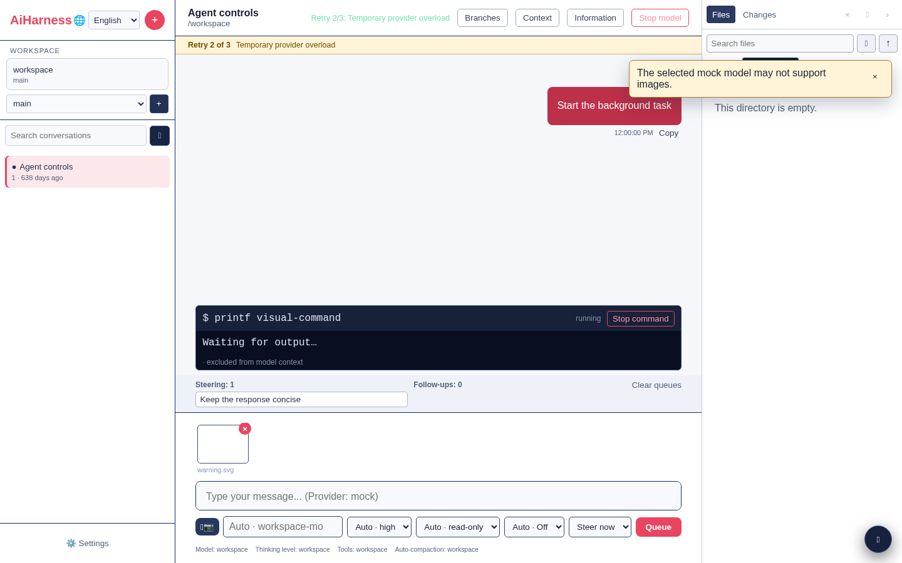

`/compact` accepte une instruction libre, affiche les tokens avant/après et le nombre économisé. L'auto-compaction applique la politique effective quand le budget de contexte le nécessite ; le sélecteur ou `/auto-compact auto|on|off` permet de restaurer l'héritage, de l'activer ou de la désactiver pour la conversation. Une compaction manuelle ou automatique affiche son état et peut être annulée depuis le bouton de phase tant que le provider travaille : le signal d'arrêt atteint la génération du résumé et aucun résumé partiel n'est appliqué. Après succès, le contexte canonique et l'historique visible sont rechargés ensemble afin que les anciens messages remplacés par le résumé ne réapparaissent pas.

Les succès, avertissements, erreurs provider/scope/extension et progressions apparaissent dans un centre de statuts global : ses messages survivent à une navigation, leur expiration est suspendue au survol ou au focus, et chaque message peut être fermé au clavier.

### Palette globale et raccourcis

`Ctrl+K` (`⌘K` sur macOS) ouvre une palette globale qui recherche les commandes, sessions, réglages et fichiers du workspace. Utilisez `↑`/`↓`, `Entrée` et `Escape` pour la parcourir. Le focus reste piégé dans la palette tant qu’elle est ouverte, puis revient au contrôle précédent.

Raccourcis par défaut :

| Action | Windows/Linux | macOS |
|---|---|---|
| Nouvelle conversation | `Ctrl+Maj+O` | `⌘⇧O` |
| Focus du composer | `Ctrl+L` | `⌘L` |
| Afficher/masquer la barre latérale | `Ctrl+Maj+S` | `⌘⇧S` |
| Afficher/masquer l’explorateur | `Ctrl+Maj+F` | `⌘⇧F` |
| Afficher/masquer le terminal | `Ctrl+Maj+T` | `⌘⇧T` |
| Ouvrir les réglages | `Ctrl+,` | `⌘,` |

Les raccourcis globaux ne capturent pas la saisie ordinaire dans un champ éditable. Leur configuration et la visibilité des panneaux sont validées puis conservées dans les préférences du navigateur.

### Images et rendu des messages

Ajoutez jusqu’à huit images par le bouton appareil photo, collage ou glisser-déposer. Le navigateur tente de réduire les images trop grandes ; la taille totale est limitée. Un avertissement apparaît si le provider choisi n’annonce pas de support multimodal. Les blocs image sont persistés avec le message et envoyés nativement à OpenAI/Azure, Anthropic et Gemini/Vertex.

Les réponses prennent en charge titres avec ancres, listes, tableaux, citations, liens, code coloré et copiable, math KaTeX, raisonnement et détails d’outils. Leur pied affiche l’horodatage, le modèle, les tokens/coût disponibles et une copie avec confirmation visuelle ; les fichiers produits par un outil sont des boutons qui ouvrent directement le viewer. Les blocs Mermaid sont chargés à la demande et disposent d’un aperçu SVG assaini, de leur source, d’un zoom accessible et d’un téléchargement ; une syntaxe non prise en charge produit une erreur locale sans injecter de contenu actif. Le HTML brut reste du texte, les sorties KaTeX sont assainies avec le mode de confiance désactivé et les liens externes utilisent une ouverture isolée.

Chaque tour d’outils est regroupé en **Process** puis **Response**. Le processus expose nom, arguments, progression, résultat ou erreur, durée, provider/modèle, tokens et coût. Les séquences ANSI sont rendues sans HTML actif. Une sortie longue reste bornée dans l’aperçu et dans le contexte modèle ; **Show complete output** charge explicitement la version complète, qui peut alors être copiée ou téléchargée.

Le collage HTML dans le composer est converti en Markdown utile (titres, listes, emphase, liens et code) après suppression des éléments actifs comme `script`, `style` et `iframe`.

Lorsque l’option **actions sur la sélection** est active, sélectionner du texte dans la conversation ouvre une barre accessible permettant de le citer dans le composer courant ou de créer un nouveau brouillon prérempli. La citation conserve les retours à la ligne et le focus revient au composer sans envoyer de message.

### Explorer, Git et fichiers

Le panneau droit propose :

- un arbre chargé paresseusement, les fichiers cachés optionnels, une recherche d’index et les badges Git `M/A/D/U` ;
- les changements Git regroupés par dossier, avec total d’additions/suppressions et ouverture directe du diff ;
- un viewer Source/Preview/Diff redimensionnable ou plein écran, avec métadonnées, numéros de ligne, coloration, copie et téléchargement ;
- un aperçu Markdown assaini avec frontmatter et ancres, ainsi que les images, fichiers audio et vidéos ;
- les diffs suivis, indexés, non suivis, supprimés ou binaires, rafraîchis lorsque le fichier ouvert change ;
- l’upload multiple annulable avec progression réseau par fichier, erreur détaillée et stratégie de collision explicite : refuser, renommer ou écraser ;
- le bouton **@** qui insère directement le chemin relatif sélectionné dans le composer, en le citant automatiquement s’il contient des espaces.

Un lien Markdown `file:src/app.ts#L20`, ou un chemin reconnu dans une sortie d’outil, ouvre le viewer à la ligne visée. Toutes ces opérations sont résolues et canonicalisées par le serveur à l’intérieur du workspace approuvé. L’upload est borné en nombre et en taille ; l’écrasement n’a lieu que si cette stratégie a été sélectionnée.

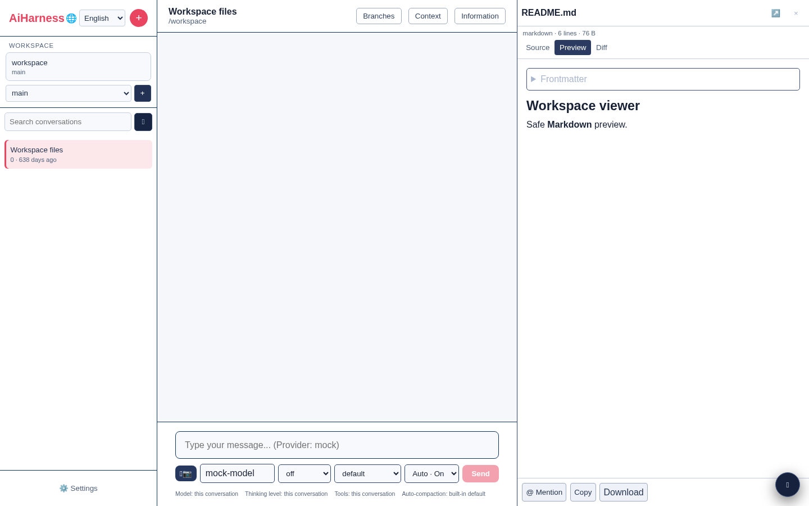

### Terminal du workspace

Le bouton `⌘` ou le raccourci `Ctrl+Maj+T` charge puis ouvre un vrai terminal PTY dans le cwd approuvé ; xterm n’est pas téléchargé avant cette première demande. Chaque onglet possède son propre shell et affiche son état, ses dimensions et son code de sortie. Le bouton `+` crée un autre terminal ; fermer un onglet actif demande confirmation puis tue son processus.

La taille suit le panneau. `Ctrl+Maj+C` copie la sélection xterm et `Ctrl+Maj+V` colle le presse-papiers lorsque le navigateur l’autorise. Les onglets et le terminal actif sont mémorisés dans `sessionStorage` par workspace pour l’onglet navigateur courant. Après un rechargement ou une coupure réseau, le client reprend le journal ANSI à son dernier offset ; il signale explicitement si la partie la plus ancienne a été évincée du journal borné.

Le serveur limite le nombre de PTY, la taille des entrées et les dimensions. Création, saisie, redimensionnement et fermeture exigent la capacité terminal ainsi qu’un workspace canonique approuvé. L’environnement initial est construit par liste blanche et n’hérite pas des tokens d’authentification ni des clés provider du serveur. La sortie de chaque PTY traverse son propre redactor stateful avant le journal de replay, les abonnés ou SSE, y compris lorsqu’un credential est réparti entre plusieurs chunks. Tous les PTY encore actifs sont arrêtés avec le serveur. Un terminal permet néanmoins d’exécuter des commandes avec les droits de l’utilisateur système du serveur : ne donnez la capacité terminal qu’à un administrateur de confiance.

### Écrans mobiles et tablettes

Sous 960 px, la barre latérale et l’explorateur deviennent des tiroirs superposés accessibles par les boutons en haut de l’écran. Le chat occupe toute la largeur, les actions secondaires passent dans une barre mobile, le viewer peut prendre tout l’écran et le terminal reste ancré au-dessus de la zone sûre PWA. Le fond du tiroir ferme le panneau actif ; `Escape` ferme les dialogues et palettes.

Les sessions sont chargées depuis le serveur au démarrage. Plusieurs onglets voient le même stockage serveur après rechargement ; les préférences d’apparence sont synchronisées par les événements du navigateur.

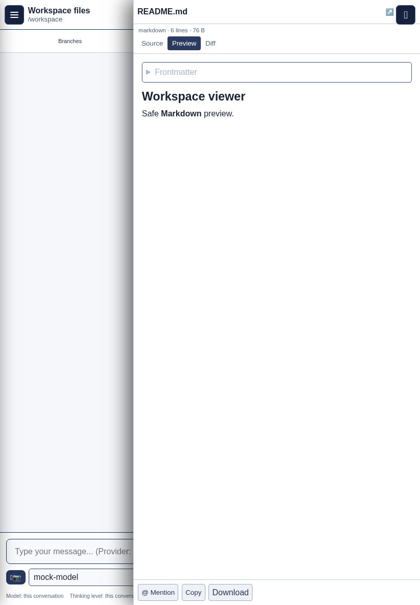

### Accessibilité

Les palettes, dialogues, zooms et tiroirs mobiles piègent le focus sans le perdre à la fermeture et acceptent `Escape`. Les zones de conversation et d’erreur utilisent des annonces ARIA non bloquantes, les contrôles ont des libellés accessibles et les états actifs ne reposent pas uniquement sur la couleur. AiHarness respecte `prefers-reduced-motion` et les couleurs forcées du système.

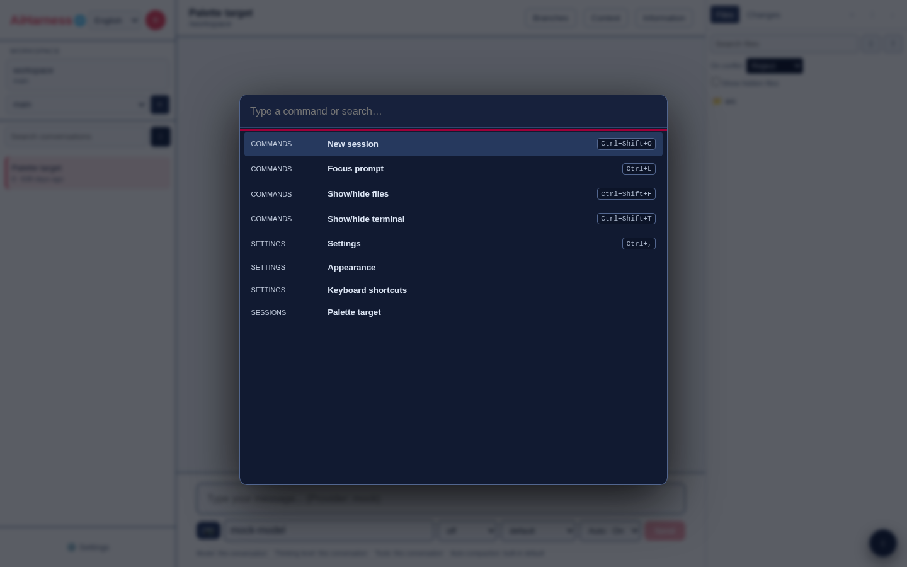

### Exécution après build sans lien global

Après `npm run build`, le même lanceur reste accessible directement :

```bash
node packages/server/dist/web-cli.js --no-open
```

Le bundle `packages/web/dist/` est servi automatiquement avec l’API. Aucun second serveur HTTP n’est nécessaire. En production publique, placez néanmoins `ai-harness-web` derrière un reverse proxy HTTPS.

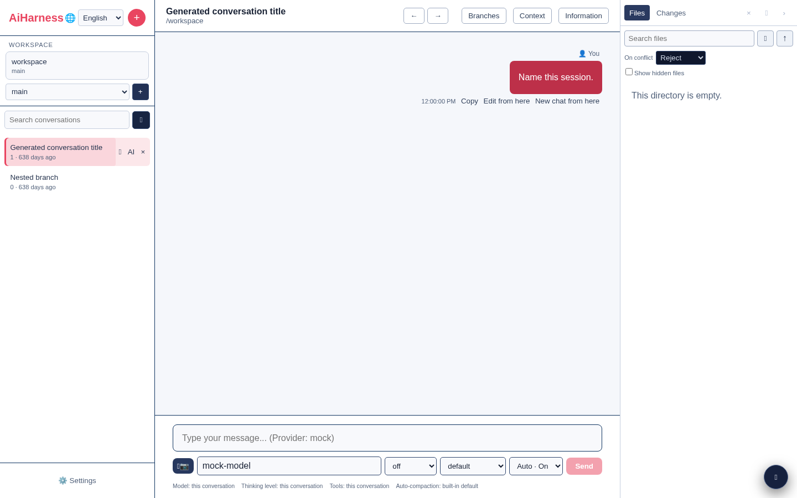
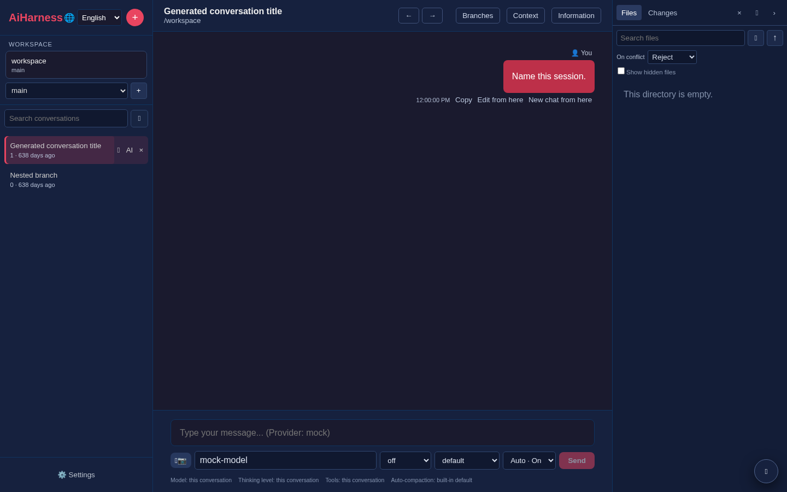

## Sessions et fichiers

Par défaut, le CLI et le serveur utilisent :

| Donnée | Emplacement |
|---|---|
| Sessions JSONL | `~/.ai-harness/sessions/<id>.jsonl` |
| Exports CLI | `~/.ai-harness/exports/` |
| Credentials Web chiffrés | `~/.ai-harness/credentials.enc` |
| Configuration non secrète par portée | `~/.ai-harness/config.json` |
| Providers/modèles personnalisés | `~/.ai-harness/providers.json` |
| Secrets de providers personnalisés (si clé maître) | `~/.ai-harness/provider-secrets.enc` |
| Métriques d’usage et de coût | `~/.ai-harness/usage-metrics.json` |
| Configuration MCP gérée par l’opérateur (peut contenir des secrets) | `~/.ai-harness/mcp.json` |
| Souscriptions/clé privée Web Push (si clé maître) | `~/.ai-harness/push.enc` |
| État des packages/plugins | `~/.ai-harness/plugins.json` |
| Packages npm/Git gérés | `~/.ai-harness/plugins/installed/` |
| Décisions de confiance des projets (autorisations/refus exacts ou hérités) | `~/.ai-harness/trust.json` |
| Extensions utilisateur | `~/.ai-harness/extensions/` |
| Skills utilisateur | `~/.ai-harness/skills/` |
| Prompts utilisateur | `~/.ai-harness/prompts/` |

Le CLI et le Web partagent leurs sessions lorsqu’ils s’exécutent avec le même utilisateur et le même répertoire personnel. Sauvegardez `~/.ai-harness/` pour conserver les conversations.

Le mode CLI `--no-session` désactive lectures et écritures. Pour un conteneur, montez un volume privé sur le dossier `.ai-harness` de l'utilisateur effectif ; voir [containerization.md](./containerization.md).

## Sécurité

### Protéger l’API Web

Définissez un token d’authentification avant de démarrer le serveur :

```bash
export AI_HARNESS_AUTH_TOKEN="$(openssl rand -hex 32)"
```

Toutes les routes `/api` demanderont alors une authentification. Sans token administrateur distinct, ce token possède aussi les capacités d’administration. Le navigateur affiche une page de connexion et reçoit, après validation, une session opaque en cookie `HttpOnly`, `SameSite=Strict`, expirant après huit heures par défaut. Les clients API peuvent continuer à envoyer `Authorization: Bearer <token>`.

Un token administrateur séparé peut protéger les changements de credentials :

```bash
export AI_HARNESS_AUTH_TOKEN='token-utilisateur'
export AI_HARNESS_ADMIN_TOKEN='token-administrateur'
```

Le token utilisateur permet chat, sessions et lectures ; le rôle administrateur est requis pour confiance/worktrees, upload, terminal, configuration, credentials et administration des packages/plugins. Pour enregistrer les clés Web chiffrées entre les redémarrages :

```bash
export AI_HARNESS_MASTER_KEY="$(openssl rand -hex 32)"
```

Sans `AI_HARNESS_MASTER_KEY`, Settings refuse avant activation les mutations de clés intégrées, d’OAuth provider et de secrets de providers personnalisés ; aucun succès n’est annoncé pour un credential volatil. Les credentials d’environnement ou de commande restent des alternatives locales au processus, tandis que les souscriptions Push demeurent volatiles jusqu’au redémarrage. Les fichiers chiffrés ne sont jamais servis au navigateur ; changer la clé maître rend leur ancien contenu illisible et entraîne une rotation sûre des données Push.

Pour les liens `/share`, configurez l’URL publique correcte :

```bash
export AI_HARNESS_PUBLIC_URL='https://ai.example.com'
```

### Écoute réseau

Le serveur écoute uniquement `127.0.0.1` par défaut. Pour une écoute réseau explicite :

```bash
ai-harness-web --hostname 0.0.0.0 --port 3080 --no-open
```

Le serveur refuse désormais une adresse non-loopback sans `AI_HARNESS_AUTH_TOKEN` ou `AI_HARNESS_ADMIN_TOKEN` (sauf dérogation dangereuse explicite `AI_HARNESS_ALLOW_INSECURE_REMOTE=1`). Placez-le derrière un reverse proxy HTTPS, conservez l’origine/host corrects et appliquez aussi un rate limiting au proxy. Pour autoriser des origines supplémentaires :

```bash
export AI_HARNESS_ALLOWED_ORIGINS='https://ai.example.com,https://admin.example.com'
```

Les mutations HTTP et les upgrades WebSocket refusent les origines non autorisées. La durée de session Web peut être ajustée entre cinq minutes et sept jours avec `AI_HARNESS_WEB_SESSION_TTL_MS`.

## Dépannage

### Le Web affiche une erreur HTTP ou ne crée pas de session

- vérifiez que `ai-harness-web` tourne sur le port choisi ;
- ouvrez `http://127.0.0.1:3080/health` avec les valeurs par défaut ;
- depuis les sources, utilisez `npm run web` afin de démarrer ensemble l’API et Vite ;
- si l’API est protégée, appliquez le bon token dans Settings.

### « Workspace non approuvé » ou `PROJECT_TRUST_REQUIRED`

Ouvrez le sélecteur de workspace, vérifiez le chemin, puis cliquez sur l’action d’utilisation et confirmez l’approbation. Dans le CLI, utilisez `/trust status`, puis `/trust allow` et `/reload`, ou relancez ponctuellement avec `--approve`; `/trust list` permet de repérer un refus hérité. Si le chemin est refusé avant cette étape, ajoutez sa racine canonique à `AI_HARNESS_ALLOWED_ROOTS` puis redémarrez le serveur. Ne contournez pas cette vérification pour un dépôt inconnu.

### « Provider not configured »

- exportez les variables avant de démarrer le processus ;
- redémarrez le CLI ou le serveur après leur modification ;
- dans le CLI, exécutez `/provider` puis `/provider <nom>` ;
- dans le Web, vérifiez le provider actif dans Settings.

### Le provider local ne répond pas

```bash
curl http://127.0.0.1:11434/v1/models
```

Adaptez `LOCAL_BASE_URL`, vérifiez le nom `LOCAL_MODEL` et assurez-vous que le modèle est chargé. Dans un conteneur, `localhost` désigne le conteneur lui-même : utilisez le nom DNS du service ou `host.docker.internal` selon l’environnement.

### Le plein écran ne fonctionne pas

Utilisez :

```bash
npm run dev --workspace @ai-harness/cli -- --regular
```

Le CLI revient automatiquement au mode classique lorsque stdin/stdout ne sont pas des TTY compatibles.

### Le presse-papiers est indisponible

Sous Linux, installez `wl-copy`, `xclip` ou `xsel`. Le CLI tente sinon OSC 52, puis affiche le contenu si aucune méthode n’est disponible.

### Réinitialiser une configuration locale

Arrêtez AiHarness et sauvegardez avant suppression :

```bash
mv ~/.ai-harness ~/.ai-harness.backup
```

Un nouveau dossier sera créé au prochain démarrage.
